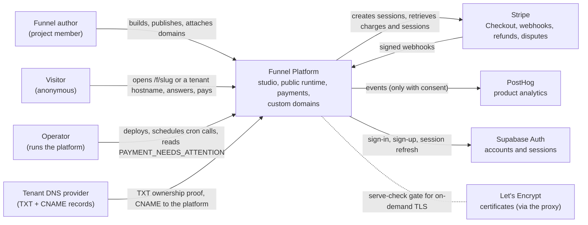
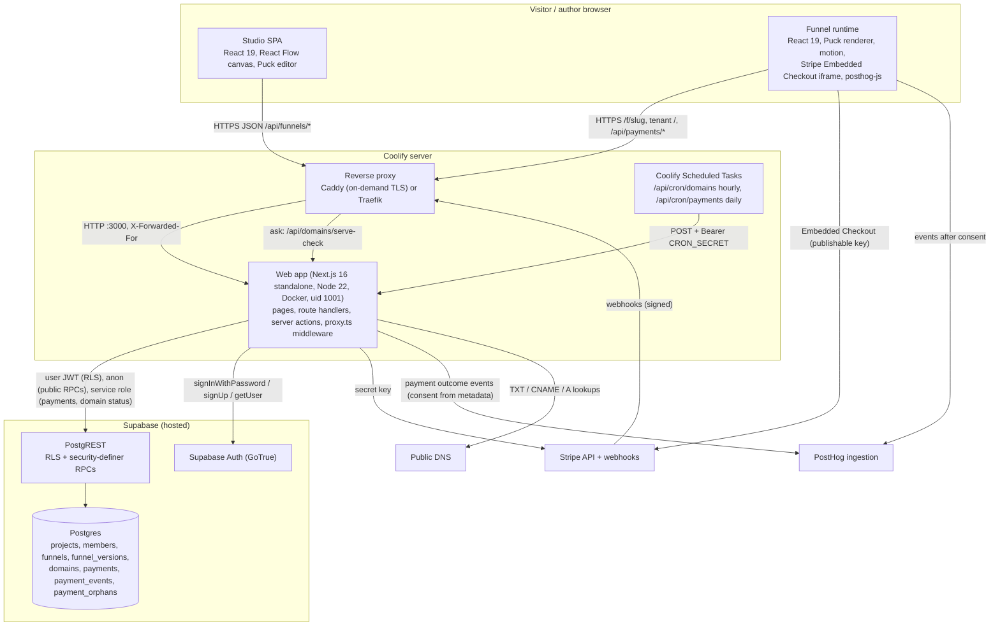
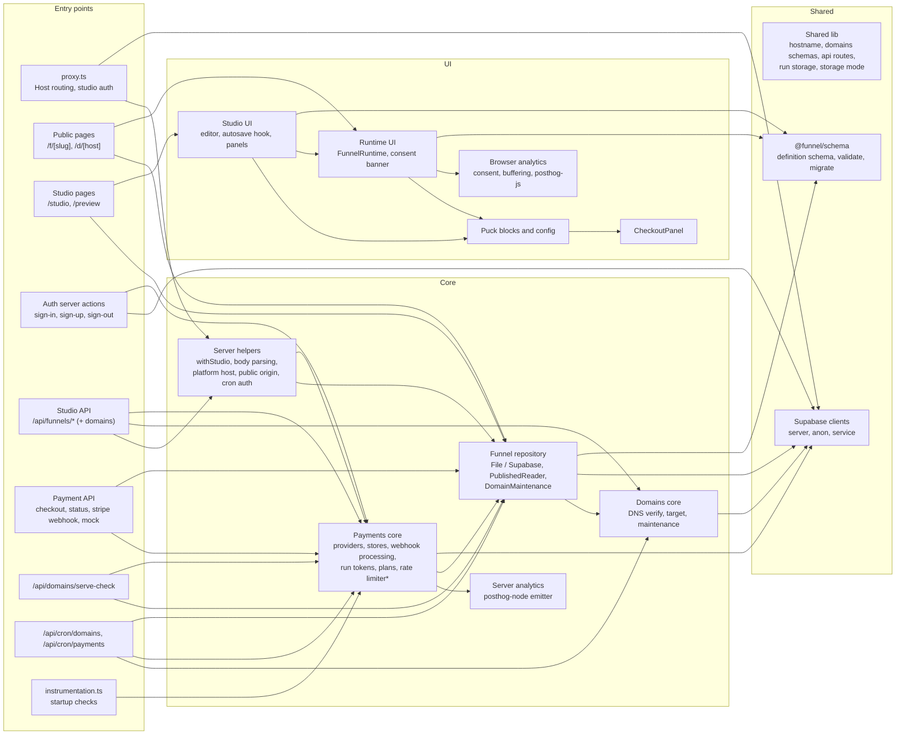

# C4 model

Related: [DATA_FLOW](./DATA_FLOW.md) | [ARCHITECTURE](./ARCHITECTURE.md) | [SECURITY](./SECURITY.md) | [DEPLOYMENT](./DEPLOYMENT.md)

Three levels: system context, containers, components of the web app. The component level is derived from the actual import graph of `apps/web/src` (108 files, value imports only, type-only imports ignored), not from intent; the table at the end lists the edges.

The code graph is also kept by graphify in `graphify-out/` (`GRAPH_REPORT.md`, `graph.html`, `graph.json`; TypeScript and SQL, no import cycles at the time of writing). Rebuild it after code changes with `graphify update .`; query it with `graphify query`, `graphify path` and `graphify explain`.

## Level 1: System context

People and external systems:

| Element | Role | Talks to the platform through |
|---|---|---|
| Funnel author | Edits funnels in the studio, publishes versions, attaches custom domains | Browser, Supabase Auth session cookie |
| Visitor | Runs a published funnel, may pay | Browser, anonymous; run state in `sessionStorage`, payer nonce cookie |
| Operator | Deploys on Coolify, runs scheduled tasks, handles alerts | Coolify, logs, `CRON_SECRET` |
| Stripe | Payment processing | Server-side API calls; signed webhooks back |
| PostHog | Analytics sink | Browser SDK (after consent) and server SDK (payment outcomes, consent carried in Stripe metadata) |
| Supabase Auth | Identity | `@supabase/ssr` cookie sessions |
| Tenant DNS | Proves domain ownership | TXT lookup from the server, CNAME/A resolution for routing |
| Let's Encrypt | TLS for tenant hostnames | Through Caddy on-demand TLS, gated by `/api/domains/serve-check` |

## Level 2: Containers

| Container | Technology | Responsibility | Holds data |
|---|---|---|---|
| Studio SPA | React 19, `@xyflow/react`, `@puckeditor/core` | Funnel editing, autosave with revisions, publish, rollback, domains panel | Unsaved draft in memory only |
| Funnel runtime | React 19, Puck renderer, `motion`, `@stripe/react-stripe-js`, `posthog-js` | Renders a published version, routes between screens, checkout, consent | `sessionStorage`: run id and answers (no emails); `localStorage`: consent decision; httpOnly cookie `fp_run_<runId>` with payer nonces |
| Reverse proxy | Caddy or Traefik (Coolify) | TLS termination, on-demand certificates for verified tenant hosts, forwarding headers | Certificates |
| Web app | Next.js 16 standalone in Docker | All server logic: pages, APIs, webhooks, auth, rate limits, Host routing | Nothing persistent in Supabase mode; in-memory rate-limit buckets; `.data/*.json` in file mode (dev only) |
| Scheduled tasks | Coolify cron | Domain re-verification, stale deferred-adjustment report | None |
| Postgres + PostgREST | Supabase | System of record; RLS for members, security-definer RPCs for public reads and privileged writes | All persistent data (see DATA_FLOW) |
| Supabase Auth | GoTrue | Accounts, password checks, sessions | `auth.users` |
| Stripe | External | Payments, refunds, disputes | Card data never reaches the platform |
| PostHog | External | Analytics | Allowlisted events keyed by run id |

## Level 3: Components of the web app

\* The in-memory `RateLimiter` lives in `server/payments/rate-limit.ts` but is used by auth, cron, serve-check, domain verification and startup checks. The graph shows it as a cross-cutting dependency on "payments core" from components that have nothing to do with payments. Recommended (not done): move it to `server/rate-limit.ts` together with `clientKeyFromHeaders` and `trustedHops`.

### Component responsibilities

| Component | Main files | Owns | Depends on |
|---|---|---|---|
| proxy.ts | `src/proxy.ts` | Custom-host routing (`/` to `/d/<host>`, everything else 404 except payments, health, serve-check), session refresh and redirects for studio paths | Server helpers (`platform-host`), Supabase SSR client |
| Public pages | `app/f/[slug]`, `app/d/[host]` | Server render of the published version, return params from Stripe | Funnel repository (PublishedReader), Runtime UI |
| Studio pages | `app/studio/**`, `app/preview/[id]` | Studio shell, draft preview | Funnel repository, Studio UI |
| Auth server actions | `app/auth/actions.ts` | Credential validation, sign-in/sign-up rate limits, safe `next` redirects | Supabase server client, RateLimiter |
| Studio API | `app/api/funnels/**` | Draft save with revisions, publish, rollback, versions, domains CRUD and DNS verify | `withStudio` (auth + error mapping), repository, domains core |
| Payment API | `app/api/payments/**` | Checkout with payer nonce, status with payer hashes, Stripe webhook entry, mock flow | Payments core, published reader |
| serve-check | `app/api/domains/serve-check` | Certificate-issuance gate for the proxy | Published reader |
| Cron | `app/api/cron/**` | Domain re-verification, stale deferred report | Domains maintenance, payment store, cron auth |
| Funnel repository | `server/*funnel-repository.ts`, `server/repository.ts` | Funnels, drafts, versions, domains (file or Supabase), published reads by slug and host | Supabase clients, `@funnel/schema` |
| Payments core | `server/payments/*` | Providers (Stripe, mock, Solidgate stub), plan catalogue, payer HMAC, stores (file/Supabase), webhook processing, adjustments | Stripe SDK, server analytics, Supabase service client |
| Domains core | `server/domains/*` | TXT/CNAME checks, CNAME target, maintenance (claim, recheck) | `node:dns`, Supabase service client |
| Server analytics | `server/analytics/posthog.ts` | posthog-node emitter with deterministic UUIDs | PostHog |
| Studio UI | `components/FunnelEditor.tsx`, `lib/use-draft-saver.ts`, panels | Canvas, screen editor, autosave, recovery, domains panel | Puck config, runtime UI (preview), `@funnel/schema` |
| Runtime UI | `components/FunnelRuntime.tsx` | Screen routing, history, run persistence, focus and announcements | Puck blocks, browser analytics, `@funnel/schema` |
| CheckoutPanel | `lib/puck/CheckoutPanel.tsx` | Checkout lifecycle in the browser: create, poll, processing, exists, return | Stripe.js, payment API |
| Browser analytics | `lib/analytics/*` | Consent, buffering until consent and run id, posthog-js with memory persistence | posthog-js |
| `@funnel/schema` | `packages/funnel-schema` | Funnel definition schema, validation, migration, next-screen logic | zod |

### Import-graph edges (value imports, grouped)

| From | To |
|---|---|
| api/payments | payments core (22), funnel repository (3), server helpers (3), supabase clients (3) |
| api/funnels (studio) | server helpers (16), domains core (5), payments core (3), shared lib (1) |
| api/cron | domains core, funnel repository, payments core, server helpers (2), supabase clients (2) |
| api/domains (serve-check) | funnel repository, payments core (rate limiter), server helpers, shared lib |
| auth | supabase clients, funnel repository, payments core (rate limiter), shared lib (2) |
| instrumentation | payments core (rate limiter), shared lib (2) |
| payments core | supabase clients (2), analytics server, funnel repository, shared lib (2) |
| funnel repository | supabase clients (2), domains core, shared lib (4) |
| domains core | supabase clients, server helpers, shared lib (4) |
| pages: public runtime | funnel repository (2), runtime UI (2), server helpers (2), shared lib |
| pages: studio & preview | studio UI (5), funnel repository (3), runtime UI |
| runtime UI | puck blocks (3), shared lib (3), analytics browser |
| studio UI | shared lib (11), puck blocks (6), runtime UI, auth (sign-out form) |
| puck blocks | shared lib (3), checkout panel |
| proxy | server helpers, shared lib, supabase clients |

External packages per component: Stripe SDK only in payments core; `@stripe/react-stripe-js` and `@stripe/stripe-js` only in CheckoutPanel; `posthog-node` only in server analytics; `posthog-js` only in browser analytics; `@supabase/*` only in Supabase clients; `@xyflow/react` only in the studio UI.
