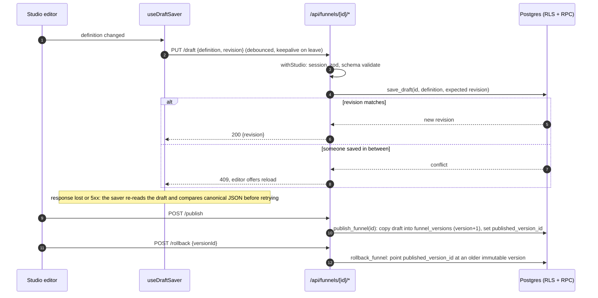
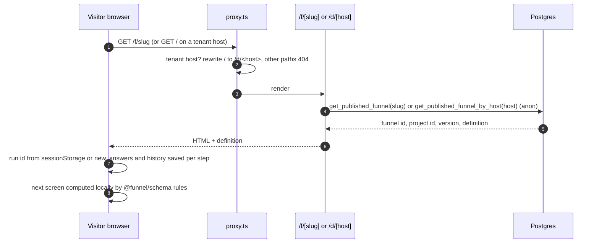
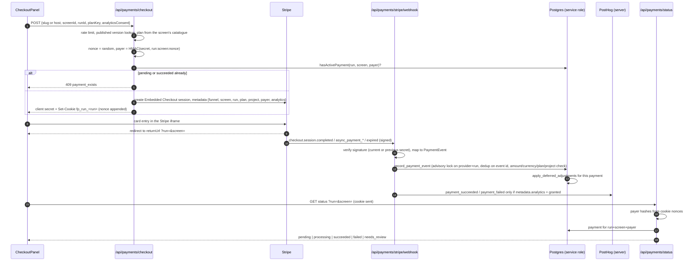
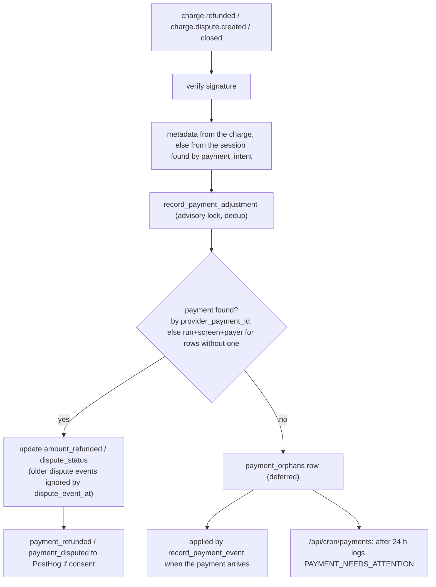
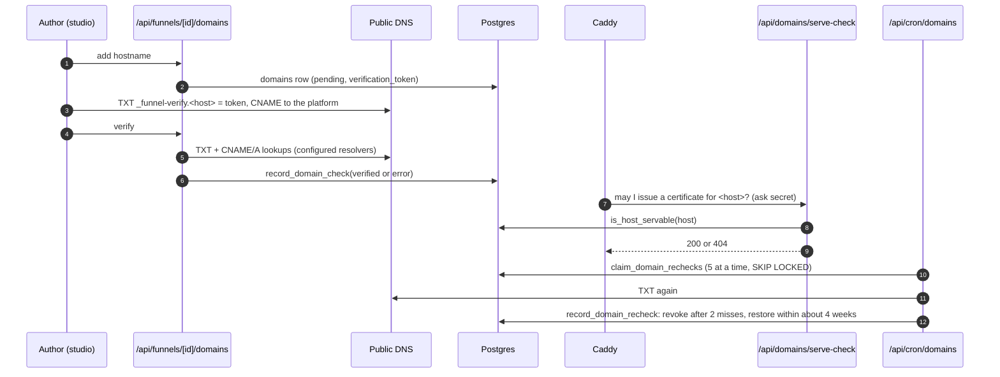
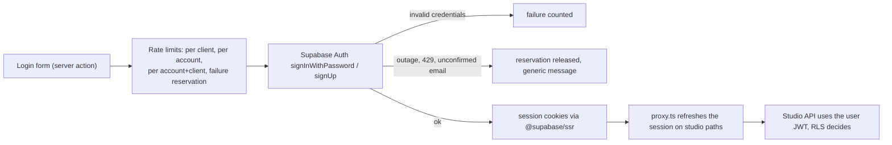

# Data flow

Related: [C4](./C4.md) | [ARCHITECTURE](./ARCHITECTURE.md) | [SECURITY](./SECURITY.md)

How data enters the platform, where it is stored, who can read it and where it leaves. Supabase mode is described; file mode (`FUNNEL_STORAGE=file`, dev only) mirrors the same rules in `.data/*.json`.

## 1. Data inventory

| Data | Where it lives | Written by | Read by | Notes |
|---|---|---|---|---|
| Accounts | `auth.users` (Supabase Auth) | Sign-up action | Supabase Auth | Passwords never touch the app's own tables |
| Projects, membership | `projects`, `project_members` | `handle_new_user` trigger, owners | RLS: members only | Roles `owner`, `editor` |
| Draft | `funnels.draft_definition`, `draft_revision` | `save_draft` RPC (member JWT) | Members | Revision is a compare-and-swap counter |
| Published versions | `funnel_versions` (immutable), `funnels.published_version_id` | `publish_funnel`, `rollback_funnel` | Anyone through `get_published_funnel*` | Validated by `funnel_definition_is_valid` |
| Run id, answers, history | Visitor `sessionStorage` (`funnel-run-id:<funnel>`, `funnel-run-state:<funnel>:<run>`) | Runtime | Runtime only | Never sent to the server except run id; emails and consent flags are kept in memory only and sent to `POST /api/leads` on advance |
| Leads (email, marketing consent) | `leads` | `record_lead` RPC (service role) from `POST /api/leads` | Members (select), studio Leads panel and CSV export | Personal data. One row per funnel, run and email; consent text copied from the live version. No retention policy yet |
| Payer nonces | httpOnly cookie `fp_run_<runId>`, 30 days, path-scoped | Checkout route | Status route | The server stores only `payer_hash` = HMAC(`RUN_TOKEN_SECRET`, run:screen:nonce) |
| Consent decision | Visitor `localStorage` | Consent banner | Browser analytics, checkout request | Copied into Stripe metadata `analytics` |
| Payments | `payments` | `record_payment_event`, `record_payment_adjustment` (service role) | Status route (service role), members (select) | Status `pending/succeeded/failed` + reason, refunds, dispute state |
| Webhook dedup | `payment_events (provider, event_id)` | Payment RPCs | RPCs | Exactly-once processing per Stripe event |
| Deferred adjustments | `payment_orphans` | `record_payment_adjustment` when no payment matches yet | `apply_deferred_adjustments`, payments cron | Refund/dispute that arrived before its payment |
| Domains | `domains` | Studio API (member), `record_domain_check`, `record_domain_recheck` | Members; `get_published_funnel_by_host`, `is_host_servable` for the public side | Verified hostname is globally unique |
| Analytics events | PostHog | posthog-js after consent, posthog-node for payment outcomes | PostHog | Allowlisted properties only, `distinct_id` = run id |
| Card data | Stripe only | Stripe iframe | Stripe | Never reaches the platform |

## 2. Authoring: draft, publish, rollback

Invariants: versions are immutable (`funnel_versions_immutable` trigger), slug and project cannot change through the guard, every stored definition is validated server-side by `@funnel/schema` and in the database.

## 3. Public runtime

Answers stay in the browser. The server sees only the run id, the screen id and the plan key when the visitor reaches a paywall, and the email address (with the consent flag) when the visitor leaves an email capture screen.

### Leads

When the visitor advances past a screen with `EmailInput` blocks, the runtime posts each valid, non-empty address to `POST /api/leads` with `{ slug, runId, screenId, blockId, email, consent }` (fetch with `keepalive`, not awaited, failures only logged to the console; never sent in preview). The route rate-limits, validates the body (4 KB cap), resolves the published version by slug, requires an `EmailInput` block with that id on that screen, lower-cases the address and calls `record_lead` with the service role. The consent text stored is the block's `consentLabel` from the live version, never browser text. Duplicates per funnel, run and email are ignored, and the answer is 204 either way. Members read leads in the studio (latest 100) or as a CSV export of all rows. PostHog never receives the address. See [Lead capture](./features/25-lead-capture.md).

## 4. Checkout, webhook, status

Key points:

- **The paywall opens only for the browser that started the checkout.** A stolen return link carries the run id but not the cookie, so its payer hash matches nothing.
- **Status mapping** is in `toPublicPaymentStatus`: a found `pending` row is `processing`; a `failed` row with an amount, currency, plan or project mismatch is `needs_review`.
- **Webhooks are idempotent.** `payment_events` rejects a repeated event id, and the advisory lock serialises events and adjustments of one run.
- **A second succeeded payment** for the same run and screen logs `PAYMENT_NEEDS_ATTENTION duplicate_payment` for a manual refund.

## 5. Refunds and disputes

Access policy (`revocationOf` in `server/payments/types.ts`, same in both stores): a full refund or Stripe `charge_refunded` closes access; an open dispute (`needs_response`, `under_review`) suspends it and a lost one keeps it closed; partial refunds, won disputes, inquiries (`warning_*`) and `prevented` keep it. The public status route reports `refunded` or `disputed` for such a payment. When a visitor's restored run has passed a checkout or upsell screen, the runtime re-checks those payments and sends the visitor back to the first revoked checkout; the panel offers "Purchase again" after a refund (a new checkout is allowed) and asks to contact support during or after a dispute (a new checkout stays blocked). The studio editor lists the funnel's latest 50 payments with their access state (`GET /api/funnels/[id]/payments`).

## 6. Analytics and consent

One owner per event, so nothing is counted twice:

| Event family | Owner | Condition |
|---|---|---|
| `funnel_view`, `screen_view`, `answer_selected`, `step_completed`, `paywall_view`, `checkout_started`, `funnel_completed` | Browser (`posthog-js`) | Consent granted in `localStorage`; events before consent are buffered in memory and dropped on refusal |
| `payment_succeeded`, `payment_failed`, `payment_refunded`, `payment_disputed` | Server (`posthog-node`) | `analytics` flag in Stripe metadata, captured at checkout time |

- **Identity.** posthog-js runs with memory persistence and `distinct_id` = run id, so no PostHog cookie is set and both sides join on the run id.
- **Retries.** Server events carry deterministic UUIDs derived from the provider event, so a webhook retry does not create a second event.
- **Allowlisted properties.** Events carry ids, never free text or emails. Selected option ids are sent only when `NEXT_PUBLIC_ANALYTICS_ANSWER_IDS=true`. Autocapture, recordings and IP capture are off.
- **Fault tolerance.** An analytics failure is logged and never fails a page, a checkout or a webhook.

## 7. Custom domains

Tenant hosts serve only the funnel root and the payment, health and serve-check endpoints. Studio, login and preview are never reachable on a tenant hostname.

## 8. Authentication

## 9. Trust boundaries

| Boundary | Untrusted input | Control |
|---|---|---|
| Browser to API | Every body and query | zod schemas, size limits, rate limits, payer cookie for payment status |
| Stripe to webhook | Webhook payload | Signature check with current and previous secret, amount/currency/plan/project re-check against the stored plan |
| Proxy to app | `X-Forwarded-For`, Host | `TRUST_PROXY_HOPS` or `CLIENT_IP_HEADER`; `PLATFORM_HOSTS` decides platform vs tenant host |
| Tenant DNS | TXT and CNAME answers | Ownership proof plus periodic re-check |
| App to Postgres | Studio writes | User JWT with RLS; service role only in payments, leads, domain status and cron paths |
| App to PostHog | Event properties | Consent gate and property allowlist |
