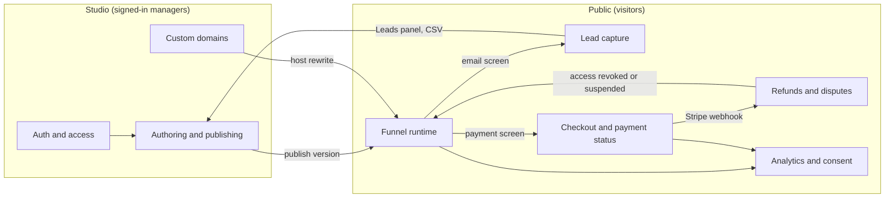

# Feature map

> Start here: every feature of the platform on one graph; click a node to open its flow

The platform has two sides. Managers build funnels in the **studio** and publish them as immutable versions. Visitors walk through the **public runtime**, pay through **Stripe**, and keep or lose access as refunds and disputes arrive. **Custom domains** put a funnel on a tenant's hostname, **analytics** records the journey after consent, and **auth** guards everything that is not public.

Each feature page has its own graph. Its nodes link to the steps below the graph, and every step names the code, the data it touches and how it fails. The full prose documents are under Reference in the sidebar.

## Map

## How a funnel lives

1. A manager signs in ([Auth and access](./70-auth-access.md)), edits the screen graph and the content of each screen, and publishes. Publishing copies the draft into an immutable version ([Authoring and publishing](./10-authoring.md)).
2. Visitors open `/f/<slug>` or a verified tenant hostname ([Custom domains](./50-custom-domains.md)). The runtime serves the live version and keeps the visitor's progress in the browser tab ([Funnel runtime](./20-runtime.md)). An email typed on an email capture screen is stored on the server when the visitor continues and shows up in the studio ([Lead capture](./25-lead-capture.md)).
3. On a payment screen the visitor goes through Stripe Checkout. The screen advances only after the Stripe webhook has recorded the payment ([Checkout and payment status](./30-checkout.md)).
4. Later refunds and disputes change the visitor's access to what they paid for ([Refunds and disputes](./40-refunds-disputes.md)).
5. Journey and payment events reach PostHog only after the visitor consents ([Analytics and consent](./60-analytics-consent.md)).

## Background jobs

| Job | Endpoint | Cadence | Feature |
|---|---|---|---|
| Domain re-verification | `POST /api/cron/domains` | hourly | [Custom domains](./50-custom-domains.md) |
| Stale refund and dispute report | `POST /api/cron/payments` | daily | [Refunds and disputes](./40-refunds-disputes.md) |

Both run as Coolify Scheduled Tasks with the `CRON_SECRET` bearer token, see [Deployment](../DEPLOYMENT.md#scheduled-re-verification).

## Keeping these pages current

Feature pages live in `docs/features/*.md` and appear in the studio automatically, with no code changes. When a change alters a flow, update that feature's graph and its step section in the same commit.
