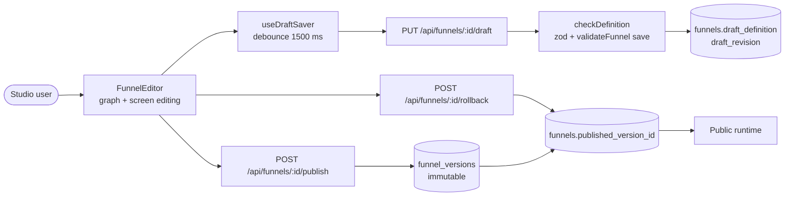
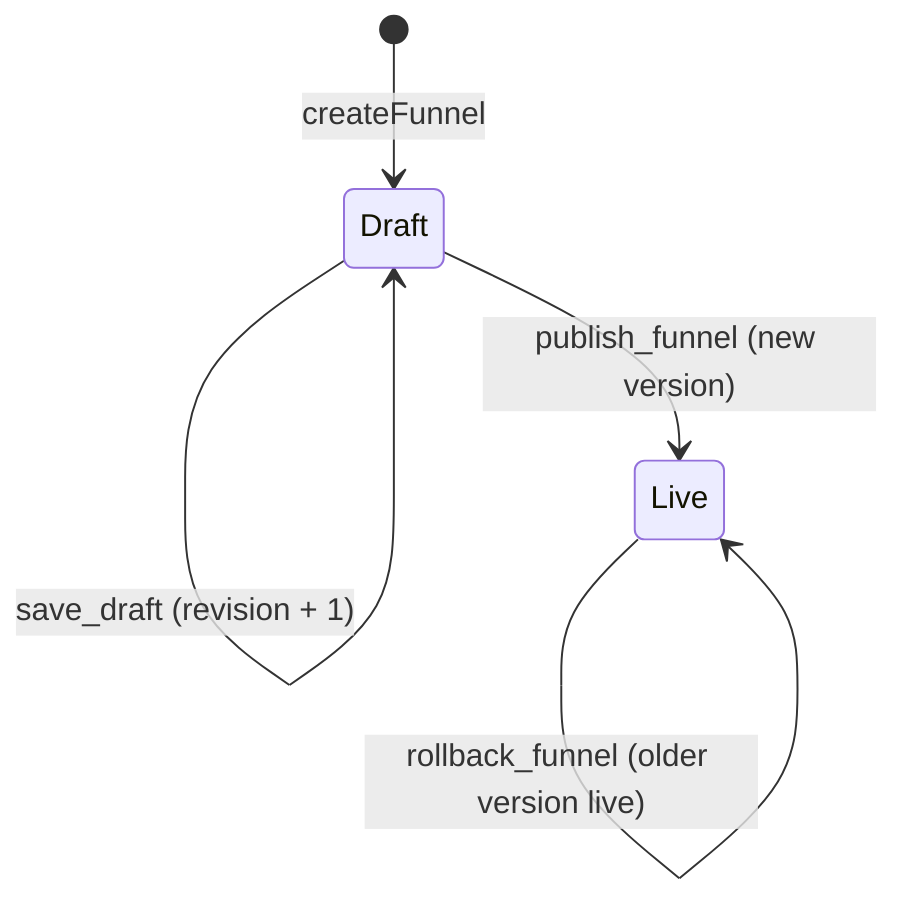

# Studio authoring

> Edit the funnel graph in Studio, autosave a revisioned draft, then publish it as an immutable version or roll back to an older one.

## What it does

A Studio user edits a funnel definition (screens, edges with conditions, theme, animations) in `FunnelEditor`. Every change is autosaved to a single mutable draft guarded by an integer `draft_revision` (optimistic concurrency). Publishing copies the draft into a new, immutable row in `funnel_versions` and points `funnels.published_version_id` at it. Rollback re-points that pointer at any older version, so the public runtime always reads one immutable snapshot.

## Flow

## Steps

### Step: Edit graph

The editor is a dark three-pane layout. The left panel has two tabs: **Screens** (search, reorder by drag, add, set start, delete) and **Elements** (the Puck outline of the current screen and the blocks to drag onto the phone). The center has two views switched at the bottom left: **Screen** edits one screen inside a phone frame, **Canvas** shows every screen as a live mini phone connected by its edges. Canvas nodes are laid out automatically by distance from the start screen (columns by BFS depth, unreachable screens in the last column) and cannot be dragged; stored `position` values are no longer used for layout. New connections are drawn between node handles. The right panel has **Parameters** (screen name, id, type, navigation, animation, or the selected element's fields) and **Styles** (the funnel theme). The rail on the canvas holds the Styles toggle and the future AI assistant ([design](./80-ai-assistant.md)).

The editor holds the `FunnelDefinition` (`screens[]`, `edges[]` with `condition`, `startScreenId`, `theme`) in `useDraftSaver`. All edits go through `saver.mutate(fn)`, which bumps a local revision counter. Changing a screen type filters content blocks to those allowed for the new type. The `ValidationPanel` lists issues and clicking one selects the offending screen.

**Code:** `apps/web/src/components/FunnelEditor.tsx`, `apps/web/src/components/ScreenCanvas.tsx`, `apps/web/src/components/ScreenEditor.tsx`, `apps/web/src/components/ConditionPicker.tsx`, `apps/web/src/components/ValidationPanel.tsx`, `apps/web/src/lib/retype-edges.ts`.
**Data:** in-memory definition only until autosave.
**Failure modes:** if the draft is in conflict (`saver.conflict`), edits stay local and are not saved; the UI asks the user to reload.

### Step: Autosave draft

`useDraftSaver` debounces saves by `AUTOSAVE_DELAY_MS` (1500 ms) and sends `PUT /draft {revision, definition}` with the last known server revision. One request is in flight at a time; edits made meanwhile are queued. On tab leave it flushes with `keepalive` when the body is at most `KEEPALIVE_MAX_BYTES` (60 000). If a response is lost (network error, 5xx, unreadable 2xx), the saver marks the attempt "uncertain"; on the next 409 with `currentRevision === sentRevision + 1` it re-reads `GET /draft` and compares canonical JSON, and only then treats the save as done.

**Code:** `apps/web/src/lib/use-draft-saver.ts` `useDraftSaver`, `attempt`, `recoverLostSave`, `flushOnLeave`, `runExclusive`.
**Data:** client refs `serverRevisionRef`, `uncertainRef`; no browser storage.
**Failure modes:** 409 -> `conflict` state and `revision_conflict` issue; 400 -> issues shown, state `error`; network error -> `error`, retried after `AUTOSAVE_DELAY_MS` when edits are queued.

### Step: Save draft route

`PUT /api/funnels/[id]/draft` runs inside `withStudio` (session via `getStudioContext`, 401 `unauthenticated` otherwise). The body is parsed with `parseJsonBody` (`{revision: int > 0, definition: unknown}`), checked by `checkDefinition`, then `repo.saveDraft`. In Supabase mode this calls the `save_draft` RPC (security definer, row lock, membership check, revision check, `funnel_definition_is_valid`). `GET` on the same route returns the current draft for recovery.

**Code:** `apps/web/src/app/api/funnels/[id]/draft/route.ts` `PUT`, `GET`; `apps/web/src/server/api-helpers.ts` `withStudio`, `mapRepositoryError`; `apps/web/src/server/supabase-funnel-repository.ts` `saveDraft`, `mapRpcError`; `supabase/migrations/20261027120000_init.sql` `save_draft`.
**Data:** `funnels.draft_definition`, `draft_schema_version`, `draft_revision` (+1 per save).
**Failure modes:** SQLSTATE `40001` -> 409 `{error: 'revision_conflict', currentRevision}`; `P0002` -> 404 `not_found` (also when not a project member); `22023` -> 400 `schema_invalid`; `FunnelValidationError` -> 400 `validation_failed`; other errors rethrown (500).

### Step: Validate definition

`checkDefinition` migrates older `schemaVersion`s with `migrate` (below `CURRENT_SCHEMA_VERSION`, currently 2), parses with `funnelDefinitionSchema`, then runs `validateFunnel(def, {mode: 'save'})`. In `save` mode gate rules (for example `payment_bypass`, `checkout_without_plan`, `dead_end`, `cycle`, `unreachable_screen`) are downgraded to warnings so drafts stay saveable; structural errors (duplicate ids, missing start screen, edges to unknown screens) block. Publish uses the default `publish` mode where gates are errors.

**Code:** `apps/web/src/server/validate-definition.ts` `checkDefinition`; `packages/funnel-schema/src/validate.ts` `validateFunnel`; `packages/funnel-schema/src/migrate.ts` `migrate`; SQL `funnel_definition_is_valid`.
**Data:** none (pure function); warnings come back in the PUT response as `warnings`.
**Failure modes:** schema failure -> `schema_invalid` issues; `MigrationError` -> `schema_invalid` with the migration message.

### Step: Publish version

The editor wraps publish in `saver.runExclusive`: it pauses autosave, calls `saveNow()`, then `POST /publish {revision}`. The route loads the draft, returns 409 `revision_conflict` on mismatch, rejects unknown plan keys (`unknown_plan`, 400, using `loadPlans` and `PLAN_BOUND_BLOCKS`), then `repo.publish`. That re-validates in strict `publish` mode (`FunnelValidationError` -> 400) and calls the `publish_funnel` RPC, which inserts `funnel_versions(version = max + 1)` and sets `status = 'published'` and `published_version_id`. The client retries once if a 409 carries the revision it already holds.

**Code:** `apps/web/src/app/api/funnels/[id]/publish/route.ts` `POST`, `unknownPlanKeys`; `apps/web/src/server/supabase-funnel-repository.ts` `publish`; `apps/web/src/components/FunnelEditor.tsx` `publish`, `requestPublish`; SQL `publish_funnel`.
**Data:** `funnel_versions` (insert), `funnels.status`, `funnels.published_version_id`.
**Failure modes:** 409 conflict -> `publishConflict` banner; 400 validation or `unknown_plan` -> issues in the panel with known plan keys; save failure -> outcome `save_failed`, nothing published.

### Step: Rollback

`POST /api/funnels/[id]/rollback {versionId}` re-points the live pointer. The repository checks the id is a UUID, loads the version, refuses it if its stored definition no longer parses with the current schema (`VersionUnreadableError` -> 409 `version_unreadable`), then calls `rollback_funnel`. No row is copied or edited, the draft is untouched, and later publishes continue numbering from the maximum version.

**Code:** `apps/web/src/app/api/funnels/[id]/rollback/route.ts` `POST`; `apps/web/src/server/supabase-funnel-repository.ts` `rollback`; `apps/web/src/components/VersionsPanel.tsx`; SQL `rollback_funnel`.
**Data:** `funnels.published_version_id`, `funnels.status`.
**Failure modes:** unknown version, wrong funnel or not a member (`P0002`, `23503`, `42501`) -> 404 `not_found`; unreadable version -> 409.

### Step: Funnel versions

`GET /api/funnels/[id]/versions` returns `{liveVersionId, versions: [{id, version, createdAt}]}` for the `VersionsPanel`. Rows in `funnel_versions` are immutable: the `funnel_versions_no_update` and `funnel_versions_no_delete` triggers raise `restrict_violation` (deletes only pass when cascaded from the funnel, `pg_trigger_depth() > 1`). `unique (funnel_id, version)` guarantees monotonic numbering. In dev, file mode (`FileFunnelRepository`) implements the same interface; production requires `FUNNEL_STORAGE=supabase`.

**Code:** `apps/web/src/app/api/funnels/[id]/versions/route.ts` `GET`; `apps/web/src/server/supabase-funnel-repository.ts` `listVersionSummaries`; `apps/web/src/server/repository.ts` `getStudioContext`; `apps/web/src/lib/storage-mode.ts` `resolveStorageMode`.
**Data:** `funnel_versions(id, funnel_id, version, schema_version, definition, created_at)`.
**Failure modes:** missing funnel -> 404; versions that fail the current schema are refused at rollback time rather than silently served.

## Related

- [Data flow: authoring](../DATA_FLOW.md#2-authoring-draft-publish-rollback)
- [Public runtime](./20-runtime.md) reads the live version
- [Custom domains](./50-custom-domains.md), [Checkout](./30-checkout.md) (plan keys), [Auth and access](./70-auth-access.md), [Map](./00-map.md)
