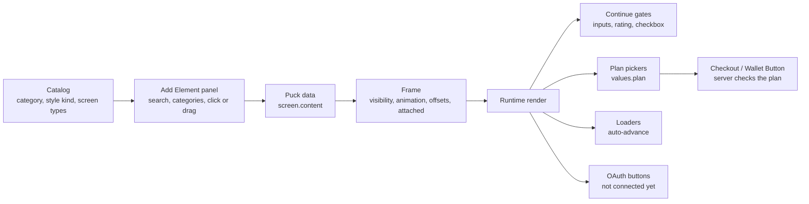

# Screen elements

> The element library: 42 base types offered as presets in 10 categories, how they are added, themed and styled, shown conditionally, gate the Continue button, act on press and bind plans to checkout.

## What it does

A screen's content is a list of Puck elements. The **Elements** tab lists the elements on the current screen; **+ Add element** opens a catalog with search and ten categories (Containers, Typography, Media & Display, Quiz, Inputs, Buttons, Authentication, Loaders, Paywall Elements, User Engagement). Each category only shows the elements allowed on the current screen type. Clicking **+** inserts the element before the first attached button and selects it; dragging puts it anywhere on the phone. Every element gets the same wrapper in the editor and in the runtime: visibility (Yes / Conditional on an answer / No), entrance animation, container offsets and, for buttons, the Attached position pinned to the bottom of the screen.

Screen types are `default`, `auth`, `paywall`, `checkout`, `upsell` and `finish` (schema v3). A screen is a quiz when it contains an **Options** element, not because of its type; the Options element's own Selection (single or multiple) decides whether edges use `answer_equals` or `answer_includes`.

## Flow

## Steps

### Step: Catalog

The menu lists **presets** (`PRESETS` in `catalog.tsx`): a base type plus preset props, e.g. Title/Subtitle/Text/Rich Text are one `Text` type with `variant`, Pulse Button is a Button with `style.effect = pulse`, Loader Set is Processing with `variant: bars`, Limited Offer is Timer with `variant: pill`. Hovering a category opens a flyout with live, scaled previews rendered by the real components; clicking a card (its + highlights on hover) inserts the element before the first button of the screen, or last if there is none, and closes the flyout; dragging a card drops it where the pointer is. Both apply the preset props (`useApplyPresets`, armed by `insertTracker` on pointer down) and give new elements `el_xxxxx` ids. The Puck preview is portaled into the canvas, outside Puck's hidden root, so `installPortalHitTest` adds that root to `document.elementsFromPoint` results over the editable phone; Puck's drop-zone plugin only reacts when its root is under the pointer, and without this drag and drop (also reordering inside the phone) never committed. Element ids of existing data are never rewritten (leads and conditions refer to them).

`CATALOG` lists every element with its category, label, hint, style kind (`text`, `button`, `options`, `box`, `media`, `none`) and the screen types it may be placed on. `allowedTypesFor(type)` drives the Puck config per screen (`configForScreenType`) and the type-change filter in the editor. The element inspector picks its style sections from the style kind, so a new element needs a catalog entry and a component, not inspector code. Containers (Columns, Rows, Carousel, Popup) use Puck slots that accept only presentational elements (`SLOT_CHILDREN`), so answers, inputs, emails and checkout never hide inside a container where the runtime, validation and lead capture would not find them.

**Code:** `apps/web/src/lib/puck/catalog.tsx`, `apps/web/src/lib/puck/config.tsx`, `apps/web/src/lib/puck/elements/*.tsx`, `apps/web/src/components/ElementInspector.tsx`.
**Data:** element props are stored as-is in `screen.content`; slot children are nested arrays in the parent's props.
**Failure modes:** an element whose props fail its zod schema renders nothing (or a placeholder) instead of crashing the screen.

### Step: Add Element panel

Rendered inside the Puck tree and portaled into the left panel. Search filters by label and hint across categories. Items are Puck `Drawer.Item`s, so they can be dragged onto the phone; the **+** button dispatches `insert` into `root:default-zone` and selects the new item.

**Code:** `apps/web/src/components/AddElementPanel.tsx`, `apps/web/src/components/ScreenEditor.tsx`.
**Failure modes:** none beyond Puck's own; an empty search shows a message.

### Step: Theme and overrides

Every element resolves its style as builtin defaults (`builtinTokens`, from the FunnelFox reference: title 28 px bold centered, button 18 px medium with radius 16 on the primary color, offsets ↑16 ↓0 ↔24 …) merged with `theme.elements[tokenKey]` and then with the element's own `props.style`. Token keys: title, subtitle, paragraph, button, options, input, other. Buttons default to Position = Attached (pinned to the bottom of the screen); inside containers the position is ignored. Screens resolve `BUILTIN_SCREEN` → `theme.screen` → `screen.style`; screen Padding ↔ applies to the header, elements carry their own side offsets. The inspector shows inherited values as placeholders, marks own values with ⚡ (click resets), and *Save as theme default* moves the element's or screen's values into the theme. Funnel settings → Theme defaults edits every token and the screen defaults. The Container block (all elements) has Offset and, under *show more*, Position (In content / Attached / Attached on scroll), Padding, Background, Roundness, Border, Border Color and Shadows; buttons add Visual Effect (pulse, shine, bounce).

**Code:** `apps/web/src/lib/styles.ts`, `apps/web/src/components/StyleFields.tsx`, `apps/web/src/components/ThemeDefaults.tsx`, `apps/web/src/lib/puck/theme-context.tsx`.
**Data:** `theme.elements`, `theme.screen` (optional, bounded record in `themeSchema`).
**Failure modes:** invalid stored values are dropped by `readStyleRecord`.

### Step: Button actions

Button Action: Do Nothing, Navigate (Destination = next screen by connections, or a specific screen; not available on payment screens), Navigate (decline path) on paywall/checkout/upsell, Show/Hide element (toggles another element's visibility), Purchase (checkout/upsell only: opens the embedded Stripe checkout for the picked or a fixed plan; the server accepts it like a Checkout block), Go to external link, Scroll to. Delay and an optional countdown (Countdown Button) apply. Button destinations count as graph edges in validation (`button_destination_missing`, reachability, dead ends) and are drawn dashed on the Canvas.

**Code:** `apps/web/src/lib/puck/elements/button.tsx`, `apps/web/src/lib/puck/editor-context.tsx`, `packages/funnel-schema/src/validate.ts`, `apps/web/src/components/ScreenCanvas.tsx`.
**Failure modes:** a destination pointing at a deleted screen is reported and ignored at runtime.

### Step: Frame

`framed(kind, Component)` wraps every element. It reads `name`, `visibility`, `visibleWhen`, `animation`, `delay` and `style` leniently (`lib/styles.ts`): invalid values are dropped. Hidden and conditional elements are dimmed in the editor and removed in the runtime until the condition matches. Attached elements are rendered by the runtime in a sticky footer (`splitData` in `FunnelRuntime`).

**Code:** `apps/web/src/lib/puck/frame.tsx`, `apps/web/src/lib/styles.ts`, `apps/web/src/components/FunnelRuntime.tsx`.
**Failure modes:** a conditional element pointing at a deleted screen or option stays hidden.

### Step: Continue gates

Input values live in the runtime's `values` map keyed `screenId:elementId` (memory only, never sent to the server or persisted). Before advancing, `screenGate` checks required Inputs (and number range, phone format), Date Pickers, Checkboxes and Ratings and shows the first message. Email Form and Email + OAuth keep using the email gate and lead capture ([Lead capture](./25-lead-capture.md)).

**Code:** `apps/web/src/lib/puck/gates.ts`, `packages/funnel-schema/src/element-props.ts`, `apps/web/src/lib/puck/elements/inputs.tsx`.
**Failure modes:** values are lost on reload; inputs other than email do not reach the studio yet.

### Step: Plan pickers

Subscription Plan Picker (simple, composite) and Trial Price Picker store the chosen Stripe plan in `values.plan`, preselecting the configured default. A Checkout block with Plan = *Picked on the paywall* or a Wallet Button uses that plan (falling back to the first picker's default). The server accepts such a checkout only if the plan is listed in a picker of the published funnel (`resolveCheckoutTarget`). Validation warns on save and fails publish when a picker option has no plan (`plan_picker_unbound`) or a payment screen has neither a fixed plan nor pickers with plans (`checkout_without_plan`). The Wallet Button opens the same embedded Stripe Checkout, where Apple Pay and Google Pay appear on supported devices.

**Code:** `apps/web/src/lib/puck/elements/paywall.tsx`, `apps/web/src/server/payments/checkout-target.ts`, `packages/funnel-schema/src/validate.ts`.
**Failure modes:** an unknown plan returns `unknown_plan`, a plan not in any picker `plan_not_bound`.

### Step: Loaders

Loader, Spinner and Processing animate over a set duration and, with *Go to the next screen*, call `next()` once when finished. They never advance inside the editor.

**Code:** `apps/web/src/lib/puck/elements/flow.tsx`.
**Failure modes:** if the screen has unmet gates, the auto-advance shows the gate message and stays.

### Step: Authentication

OAuth Button(s) and Email + OAuth render the provider buttons, but no provider is connected: clicking shows "not connected" and the editor marks them. Connecting Google/Apple sign-in for visitors needs a decision on where visitor identities are stored.

**Code:** `apps/web/src/lib/puck/elements/inputs.tsx`.
**Failure modes:** none; the email part works as a normal Email Form.
