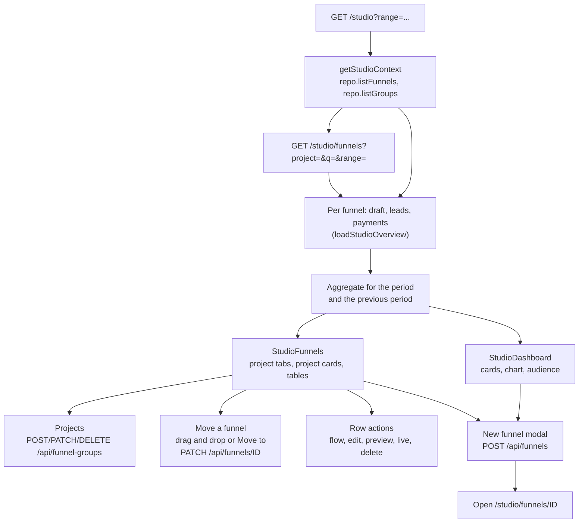

# Studio overview

> The `/studio` home page sums up leads, paid orders and revenue across every funnel the manager can see and plots them over a chosen period; `/studio/funnels` lists the funnels grouped into projects with their own numbers.

## What it does

The overview is the first page after sign-in. A server component loads the manager's funnels, then for each funnel its draft (for the screen count), its leads and its payments, and aggregates them for the selected period (`?range=7d`, `30d` or `year`, default `30d`). It shows four cards with a change against the previous period of the same length, a leads and paid orders chart and the share of leads that opted in to marketing email. Visitor counts are not shown: they live only in PostHog.

The funnel list lives on its own page, `/studio/funnels`. Funnels can be grouped into projects (`funnel_groups`, shown as "Projects" in the UI). A project is a folder inside the workspace: it does not change ownership, RLS, domains or payments, which stay scoped by the workspace (`projects` table). Creating a funnel happens in a modal and opens the new funnel in the editor.

## Flow

## Steps

### Step: Load funnels

Both pages redirect to `/login?next=...` without a studio context, then list the funnels and projects through the repository of the current storage mode, so Supabase RLS limits the lists to the manager's workspaces.

**Code:** `apps/web/src/app/studio/page.tsx`, `apps/web/src/app/studio/funnels/page.tsx`, `apps/web/src/server/repository.ts` (`getStudioContext`).
**Data:** `funnels`, `funnel_groups` (`.data/groups/*.json` in file mode).
**Failure modes:** a repository error renders the studio error page.

### Step: Load per-funnel data

For every funnel the server reads the draft (`repo.getDraft`), all leads (`LeadStore.listFunnelLeads` with no limit) and up to 5000 payments (`PaymentStore.listFunnelPayments`), in parallel. A failing lead or payment store does not break the page: that source counts as unavailable and a notice names it.

**Code:** `apps/web/src/server/studio-overview.ts` (`loadStudioOverview`, `safeLeads`, `safePayments`, `safeScreens`).
**Data:** drafts, `leads`, `payments` (service role in Supabase mode, `.data/*.json` in file mode).
**Failure modes:** a missing `SUPABASE_SERVICE_ROLE_KEY` makes leads and payments unavailable; a funnel with more than 5000 payments is undercounted.

### Step: Aggregate

The period is the last 7 or 30 UTC days (daily buckets) or the current UTC year (monthly buckets); the previous period has the same length just before it. A paid order is a `succeeded` payment that is not refunded or disputed (`revocationOf`); its revenue is `amount - amountRefunded` in minor units. Revenue is grouped by currency and the card shows the largest one, with a note when others exist. Lead to paid is paid orders divided by leads in the period. The opt-in share counts leads stored with `consent = true`. Each funnel row carries its `groupId`.

**Code:** `apps/web/src/server/studio-overview.ts` (`buildWindow`, `isPaid`, `netAmount`, `parseRange`).
**Data:** derived only.
**Failure modes:** the trend chip is hidden when both periods are zero and reads "New" when only the previous one is zero.

### Step: Render the overview

`StudioDashboard` draws the cards (sparkbars compress the series to ten bars), an SVG area chart with a dashed paid line and a conic-gradient donut. The header search is a GET form to `/studio/funnels?q=...`. The greeting uses the browser clock and the first name guessed from the email; the period select changes `?range`.

The sidebar, header and New funnel modal come from `StudioShell`, which the funnel list and the documentation pages share; on narrow screens the sidebar is hidden and the header shows Overview, Funnels and Docs links. The studio uses the same dark palette as the editor.

**Code:** `apps/web/src/components/StudioShell.tsx`, `apps/web/src/app/studio/shell-props.ts`, `apps/web/src/components/StudioDashboard.tsx`, `apps/web/src/components/StudioDashboard.module.css`.
**Data:** none.
**Failure modes:** none beyond the loaders.

### Step: Render the funnel list

`StudioFunnels` shows a tab per project (All funnels, each project, No project) with counts; the selected tab is kept in `?project=` with `history.replaceState`. In "All funnels" every project gets a card with its own table, followed by "No project" when it has funnels; without projects there is a single "All funnels" card and a hint. The header search filters rows on the client by name or slug and hides empty cards. Row actions open the editor in Flow view (`/studio/funnels/ID?view=flow`) or Editor view, and a menu offers Preview draft, Open live page (published funnels only), Move to (other projects, No project) and Delete funnel.

**Code:** `apps/web/src/components/StudioFunnels.tsx`, `apps/web/src/components/DeleteFunnelButton.tsx`.
**Data:** none.
**Failure modes:** delete errors appear next to the menu item; other errors show a notice above the cards and the page refreshes from the server.

### Step: Manage projects

"New project" opens an inline name field and posts `{ name }` (1-80 characters) to `POST /api/funnel-groups`; the new project becomes the selected tab. The project card menu renames it (`PATCH /api/funnel-groups/ID`) or deletes it (`DELETE /api/funnel-groups/ID`) after a confirmation; its funnels stay and become ungrouped (`on delete set null (group_id)` in Supabase, an explicit rewrite in file mode).

**Code:** `apps/web/src/app/api/funnel-groups/route.ts`, `apps/web/src/app/api/funnel-groups/[id]/route.ts`, `apps/web/src/server/supabase-funnel-repository.ts`, `apps/web/src/server/file-funnel-repository.ts` (`listGroups`, `createGroup`, `renameGroup`, `deleteGroup`), `supabase/migrations/20261103120000_funnel_groups.sql`.
**Data:** `funnel_groups` (RLS: any workspace member may read, create, rename and delete; only `name` is updatable).
**Failure modes:** an unknown or foreign project id returns 404 `not_found`.

### Step: Move a funnel

A row can be dragged onto a project tab or card, or moved with Move to in its menu. The UI moves it optimistically and sends `PATCH /api/funnels/ID` with `{ groupId }` (`null` for No project); on failure it reverts and shows the HTTP status. The composite foreign key `(group_id, project_id)` keeps a funnel inside a project of its own workspace.

**Code:** `apps/web/src/app/api/funnels/[id]/route.ts`, `moveFunnel` in both repositories.
**Data:** `funnels.group_id`.
**Failure modes:** a project from another workspace or a deleted one returns 404; a deleted funnel returns 404.

### Step: Create a funnel

The modal posts `{ name, slug, groupId }` to `POST /api/funnels`. When projects exist it shows a Project select, preselected when the modal is opened from a project card's New funnel button. On 201 it navigates to the new funnel's editor; 409 shows "That slug is already taken".

**Code:** `apps/web/src/components/NewFunnelForm.tsx`, `apps/web/src/app/api/funnels/route.ts`.
**Data:** `funnels`, first draft.
**Failure modes:** invalid name or slug is rejected in the form; an unknown project returns 404; other HTTP errors show their status.
