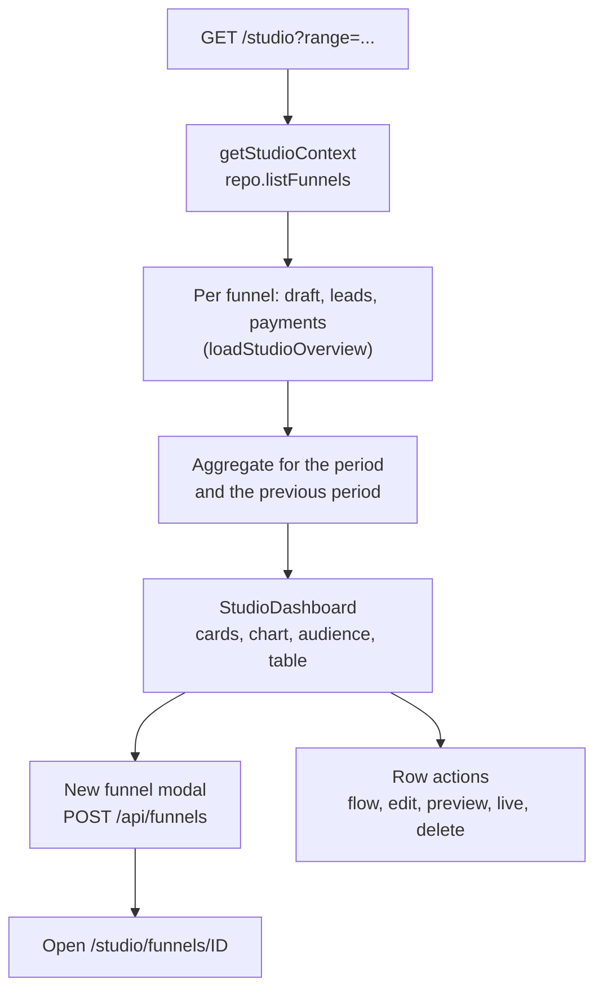

# Studio overview

> The `/studio` home page sums up leads, paid orders and revenue across every funnel the manager can see, plots them over a chosen period and lists the funnels with their own numbers.

## What it does

The overview is the first page after sign-in. A server component loads the manager's funnels, then for each funnel its draft (for the screen count), its leads and its payments, and aggregates them for the selected period (`?range=7d`, `30d` or `year`, default `30d`). It shows four cards with a change against the previous period of the same length, a leads and paid orders chart, the share of leads that opted in to marketing email, and a table of funnels with status, leads, paid orders and revenue. Visitor counts are not shown: they live only in PostHog. Creating a funnel happens in a modal and opens the new funnel in the editor.

## Flow

## Steps

### Step: Load funnels

The page redirects to `/login?next=/studio` without a studio context, then lists the funnels through the repository of the current storage mode, so Supabase RLS limits the list to the manager's projects.

**Code:** `apps/web/src/app/studio/page.tsx`, `apps/web/src/server/repository.ts` (`getStudioContext`).
**Data:** `funnels`.
**Failure modes:** a repository error renders the studio error page.

### Step: Load per-funnel data

For every funnel the server reads the draft (`repo.getDraft`), all leads (`LeadStore.listFunnelLeads` with no limit) and up to 5000 payments (`PaymentStore.listFunnelPayments`), in parallel. A failing lead or payment store does not break the page: that source counts as unavailable and a notice names it.

**Code:** `apps/web/src/server/studio-overview.ts` (`loadStudioOverview`, `safeLeads`, `safePayments`, `safeScreens`).
**Data:** drafts, `leads`, `payments` (service role in Supabase mode, `.data/*.json` in file mode).
**Failure modes:** a missing `SUPABASE_SERVICE_ROLE_KEY` makes leads and payments unavailable; a funnel with more than 5000 payments is undercounted.

### Step: Aggregate

The period is the last 7 or 30 UTC days (daily buckets) or the current UTC year (monthly buckets); the previous period has the same length just before it. A paid order is a `succeeded` payment that is not refunded or disputed (`revocationOf`); its revenue is `amount - amountRefunded` in minor units. Revenue is grouped by currency and the card shows the largest one, with a note when others exist. Lead to paid is paid orders divided by leads in the period. The opt-in share counts leads stored with `consent = true`.

**Code:** `apps/web/src/server/studio-overview.ts` (`buildWindow`, `isPaid`, `netAmount`, `parseRange`).
**Data:** derived only.
**Failure modes:** the trend chip is hidden when both periods are zero and reads "New" when only the previous one is zero.

### Step: Render

`StudioDashboard` draws the cards (sparkbars compress the series to ten bars), an SVG area chart with a dashed paid line, a conic-gradient donut and the funnel table. The search field filters the table on the client by name or slug. Row actions open the editor in Flow view (`/studio/funnels/ID?view=flow`) or Editor view, and a menu offers Preview draft, Open live page (published funnels only) and Delete funnel. The greeting uses the browser clock and the first name guessed from the email; the period select changes `?range`.

The sidebar, header and New funnel modal come from `StudioShell`, which the documentation pages share; on narrow screens the sidebar is hidden and the header shows Overview and Docs links.

**Code:** `apps/web/src/components/StudioShell.tsx`, `apps/web/src/app/studio/shell-props.ts`, `apps/web/src/components/StudioDashboard.tsx`, `apps/web/src/components/StudioDashboard.module.css`, `apps/web/src/components/DeleteFunnelButton.tsx`.
**Data:** none.
**Failure modes:** delete errors appear next to the menu item.

### Step: Create a funnel

The modal posts `{ name, slug }` to `POST /api/funnels`. On 201 it navigates to the new funnel's editor; 409 shows "That slug is already taken".

**Code:** `apps/web/src/components/NewFunnelForm.tsx`, `apps/web/src/app/api/funnels/route.ts`.
**Data:** `funnels`, first draft.
**Failure modes:** invalid name or slug is rejected in the form; other HTTP errors show their status.
