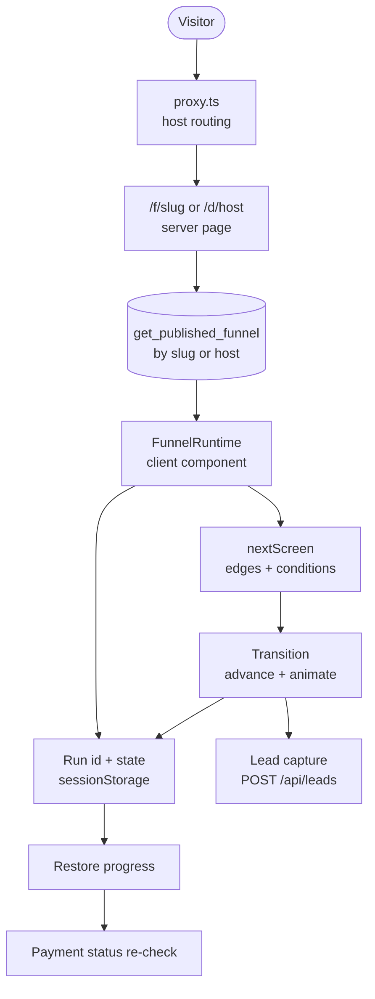

# Public runtime

> Serve the live funnel version at /f/<slug> or a custom host and walk the visitor through screens entirely in the browser, with resumable progress.

## What it does

A visitor opens `/f/<slug>` (or `/` on a verified custom host, which `proxy.ts` rewrites to `/d/<host>`). A server component loads the live immutable version through anonymous RPCs and hands the definition to the client component `FunnelRuntime`. The browser keeps a run id and the answers in `sessionStorage`, computes the next screen locally with `nextScreen` from `@funnel/schema`, and animates transitions. The server only learns the run id and screen id when the visitor reaches payment or analytics.

## Flow

## Steps

### Step: Host routing

`proxy.ts` `route` calls `customHost(headers)`. If the request host is not a platform host: `/` is rewritten to `/d/<normalized host>`, a short allow-list (`/api/payments/`, `/api/health`, `/api/domains/serve-check`, `/__nextjs`) passes through, and everything else (including `/f/...` and `/studio`) returns an empty 404. On platform hosts `/d` and `/d/*` return 404 so the host route cannot be reached directly. A per-request nonce CSP is attached to every non-API response.

**Code:** `apps/web/src/proxy.ts` `proxy`, `route`; `apps/web/src/server/platform-host.ts` `customHost`; `apps/web/src/server/csp.ts`.
**Data:** none; reads host headers.
**Failure modes:** host fails `normalizeHostname` -> treated as no custom host; unknown path on a custom host -> 404.

### Step: Load live version

`apps/web/src/app/f/[slug]/page.tsx` calls `getPublishedReader().getPublishedBySlug(slug)`; `apps/web/src/app/d/[host]/page.tsx` normalizes the host (must equal the path segment) and calls `getPublishedByHost`. Supabase mode uses the anon-callable security-definer RPCs `get_published_funnel(p_slug)` and `get_published_funnel_by_host(p_host)`, which join `funnels.published_version_id` to `funnel_versions` and require `funnels.status = 'published'` (the host variant also `domains.status = 'verified'`). The stored JSON is parsed with `parseStoredDefinition`. Pages are `force-dynamic`, so a publish or rollback is live on the next request. Return params (`run`, `screen`, `session_id`) are parsed by `parseReturnParams`.

**Code:** `apps/web/src/app/f/[slug]/page.tsx`, `apps/web/src/app/d/[host]/page.tsx`, `apps/web/src/server/supabase-funnel-repository.ts` `SupabasePublishedReader`, `apps/web/src/server/stored-definition.ts` `parseStoredDefinition`, `apps/web/src/server/return-params.ts` `parseReturnParams`; SQL `get_published_funnel` (init migration), `get_published_funnel_by_host` (`20261030120000_domains.sql`).
**Data:** `funnels`, `funnel_versions`, `domains` (read only, anon).
**Failure modes:** invalid slug, no live version, unverified host, or unparsable definition -> `notFound()` (404); RPC error -> thrown (500, `error.tsx`).

### Step: Render screen

`FunnelRuntime` runs `migrate` on the definition and checks `startScreenId` exists; otherwise it renders "This funnel cannot be displayed" (detail only when `label` is passed, as in Studio preview). `RuntimeInner` starts at `definition.startScreenId`, renders the screen content, validates email blocks, and renders `ScreenHeaderBar` from `screen.header`: progress (line, N segments, or one segment per screen group), Back, a `step/total` counter (`longestPathFrom` in `apps/web/src/packages/funnel-schema/src/progress.ts` gives the total), a title and optional logo and image. Back, counter and progress default to on. With `screen.autoNavigation` on a screen whose Options element is single choice, picking an answer advances after 250 ms. Screen styles (`screen.style`: padding, font, background color/image/video) apply to the page; attached elements render in a sticky footer; other input values and gates are described in [Screen elements](./12-elements.md). The same component powers `/preview/*` in Studio (no `slug`, so no persistence).

**Code:** `apps/web/src/components/FunnelRuntime.tsx` `FunnelRuntime`, `parseDefinition`, `RuntimeInner`, `longestPathFrom`; `apps/web/src/app/preview/`.
**Data:** none beyond the definition.
**Failure modes:** invalid definition -> public error card with `role="alert"`, details logged via `console.error`.

### Step: Run token and state

On mount with a `slug`, `getOrCreateRunId(funnelId)` reads `funnel-run-id:<funnelId>` from `sessionStorage`; it is reused only if it matches `RUN_ID_PATTERN` (`^[A-Za-z0-9_-]{16,64}$`), otherwise `randomId(32)` is stored. After restore, every state change writes `funnel-run-state:<funnelId>:<runId>` via `saveRun` with `{currentScreenId, answers, history[{screenId, answers}]}`; history is capped at `MAX_RUN_HISTORY` (500). Emails, consent flags and payment results are deliberately not persisted; emails are posted to the server when the visitor advances (see [Lead capture](./25-lead-capture.md)).

**Code:** `apps/web/src/lib/run-storage.ts` `getOrCreateRunId`, `adoptRunId`, `saveRun`, `loadRun`; `apps/web/src/lib/run-state.ts` `advance`, `retreat`; `apps/web/src/lib/ids.ts` `randomId`.
**Data:** `sessionStorage` keys `funnel-run-id:*`, `funnel-run-state:*:*`.
**Failure modes:** `sessionStorage` blocked -> `storage()` returns null and warns, the funnel works but does not resume; write errors are caught and logged.

### Step: Restore progress

`loadUsableRun` accepts saved state only if the current screen and every history screen still exist in the live definition (a new publish that removed screens discards stale progress). When the visitor returns from a payment provider (`?run=&screen=`), `adoptRunId` takes the run id from the URL and, if nothing was saved, jumps to that checkout or upsell screen. On a normal restore, up to `MAX_VERIFIED_PAYMENTS` (5) most recent paid steps are re-checked with `fetchPaymentStatus`; a `refunded` or `disputed` status rewinds history to that screen and clears payments.

**Code:** `apps/web/src/components/FunnelRuntime.tsx` `loadUsableRun`, the restore `useEffect`, `fetchPaymentStatus`; `apps/web/src/lib/run-storage.ts` `loadRun` (zod `persistedSchema`).
**Data:** `sessionStorage`; reads payment status from the payments API (see Checkout).
**Failure modes:** corrupt JSON or schema mismatch -> `loadRun` returns null (start fresh); payment re-check errors are logged and ignored.

### Step: Screen routing

`nextScreen(definition, currentScreenId, answers, payments, {fallbackOnly})` filters edges by `sourceScreenId` and returns the first whose condition matches, in array order: `always`, `answer_equals`, `answer_includes` (by `screenId` and `optionId`), `payment_succeeded`; `default` edges are only the fallback. Payment screens (`isPaymentType`) advance only through a matching `payment_succeeded` edge, so payment cannot be bypassed. `fallbackOnly` takes the `default` edge from skippable screens. Evaluation happens in the browser; answers never reach the server.

**Code:** `packages/funnel-schema/src/next-screen.ts` `nextScreen`, `matches`; `apps/web/src/components/FunnelRuntime.tsx` continue handler.
**Data:** in-memory `answers`, `payments`, `emails`, `consents`. On a successful advance, each valid address on the screen is sent to `POST /api/leads` (not in preview), see [Lead capture](./25-lead-capture.md).
**Failure modes:** `null` on a checkout or upsell -> inline message ("Complete your payment to continue." or "This offer cannot be declined here."); `null` elsewhere -> fatal "Dead end"; target missing -> fatal "The next screen ... does not exist". Publish-time `validateFunnel` is meant to prevent both.

### Step: Transitions

After a target is chosen the runtime tracks `step_completed`, calls `advance` (pushes the current screen and answers to history, clears stale answers for the target) and sets the new `currentScreenId`. `AnimatePresence mode="wait"` animates by `screen.animation.preset` and `durationMs`; animation is skipped when the user prefers reduced motion or the preset is `none`. Back uses `retreat` to pop history and restore the previous answers.

**Code:** `apps/web/src/lib/run-state.ts` `advance`, `retreat`; `apps/web/src/components/FunnelRuntime.tsx` `PRESETS`, `back`.
**Data:** state persisted by the run-state effect after each change.
**Failure modes:** none server-side; Back is disabled when history is empty.

## Related

- [Data flow: public runtime](../DATA_FLOW.md#3-public-runtime)
- [Authoring](./10-authoring.md) produces the live version, [Lead capture](./25-lead-capture.md), [Checkout](./30-checkout.md), [Custom domains](./50-custom-domains.md), [Analytics and consent](./60-analytics-consent.md), [Map](./00-map.md)
