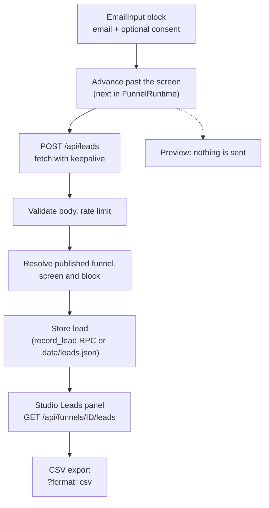
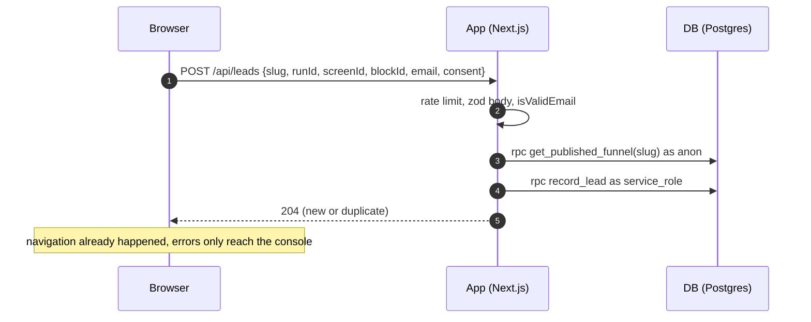

# Lead capture

> An email typed on an email capture screen is sent to the server when the visitor continues, stored once per run, and listed in the studio with a CSV export.

## What it does

The `EmailInput` block collects an address and, when the block has a consent label, an optional marketing consent checkbox. When the visitor advances past the screen, the runtime posts every valid, non-empty address on that screen to the public `POST /api/leads` endpoint without waiting for the answer. The server checks the address against the live published version, takes the consent text from that version rather than from the browser, and stores one row per funnel, run and email. Managers see the latest leads on the funnel editor page and download every lead as CSV. Leads never go to PostHog.

## Flow

## Steps

### Step: Collect email and consent

`EmailInputBlock` keeps the typed address in the runtime's `emails` map and the checkbox in `consents`, both keyed by `emailKey(screenId, blockId)`. The checkbox renders only when `consentLabel` is non-empty, starts unchecked and is never required. `emailInputProps` (`label`, `placeholder`, `required`, `consentLabel` with default `''`) lives in a shared module so the server parses the block the same way; funnels saved before the field existed still parse. Neither map is written to sessionStorage, so a reload or a payment redirect forgets both.

**Code:** `apps/web/src/lib/puck/config.tsx` (`EmailInputBlock`, the `EmailInput` editor fields), `apps/web/src/lib/email.ts` (`emailInputProps`, `emailKey`, `isValidEmail`, `emailBlocksOf`), `apps/web/src/lib/run-state.ts`, `apps/web/src/lib/run-storage.ts` (`saveRun` keeps only answers and history).
**Data:** browser run state only.
**Failure modes:** a block whose props do not parse shows "Invalid email block" and the screen cannot continue.

### Step: Send on advance

`next()` validates every email block on the screen first (required and format). Only when the screen really advances does it call `sendLead` once per block with a non-empty address, then moves on without waiting. `sendLead` uses `fetch` with `keepalive: true`, so the request survives a page change, and logs a console warning on a network error or a non-2xx answer. Nothing is sent without a slug and run id, which means the studio preview (`/preview/ID` and the editor pane) never sends leads. Going back and advancing again sends the address again; the server treats it as a duplicate.

**Code:** `apps/web/src/components/FunnelRuntime.tsx` (`next`, `emailBlocks`), `apps/web/src/lib/leads.ts` (`sendLead`, `LEADS_ROUTE`).
**Data:** request body `{ slug, runId, screenId, blockId, email, consent }`. No analytics event carries the address.
**Failure modes:** the visitor never sees an error; a lost request means a lost lead (there is no retry queue).

### Step: Validate request

The route first applies a per-client limit (30 per minute per client behind a trusted proxy, 300 per minute for the shared `direct` key, via `ipLimit`), reads at most 4 KB of JSON, and validates `slug` (`slugSchema`), `runId` (`runIdSchema`), `screenId` (`screenIdSchema`), `blockId` (1 to 100 characters), `email` (`isValidEmail`) and `consent` (boolean, default `false`). A second limit allows 10 leads per minute per slug and run. `/api/leads` is in `CUSTOM_HOST_PATHS`, so it also answers on verified tenant hostnames.

**Code:** `apps/web/src/app/api/leads/route.ts` (`POST`), `apps/web/src/server/parse-body.ts` (`parseJsonBody` with a byte cap), `apps/web/src/server/rate-limit.ts` (`checkRateLimit`, `clientKey`, `ipLimit`), `apps/web/src/proxy.ts` (`CUSTOM_HOST_PATHS`).
**Data:** none.
**Failure modes:** 400 `invalid_json` or `invalid_body`; 413 `payload_too_large`; 429 `rate_limited` with `retry-after`.

### Step: Resolve target

`resolveLeadTarget` loads the live version by slug through the published reader (file repository or the anon `get_published_funnel` RPC), finds the screen and the `EmailInput` block with the given id, and returns the funnel, project, version number and the block's trimmed `consentLabel`. Consent counts only when the browser sent `true` and the live block has a label; the stored `consent_text` is that label, never text from the request.

**Code:** `apps/web/src/server/leads/lead-target.ts` (`resolveLeadTarget`), `apps/web/src/server/repository.ts` (`getPublishedReader`).
**Data:** published funnel version.
**Failure modes:** 404 `funnel_not_found` (unknown or unpublished slug), 404 `screen_not_found`, 404 `block_not_found` (no such `EmailInput` on the screen, or its props do not parse).

### Step: Store lead

The address is trimmed and lower-cased (`normalizeEmail`) and stored through the lead store chosen by storage mode. In Supabase mode `SupabaseLeadStore` calls the `record_lead` RPC with the service role key; the security-definer function reads `project_id` from `funnels`, looks up `version_id` from `funnel_versions` by version number, and inserts with `on conflict (funnel_id, run_id, email) do nothing`. In file mode `FileLeadStore` appends to `.data/leads.json` under an in-process lock with the same dedupe. New and duplicate leads both answer 204.

**Code:** `apps/web/src/server/leads/registry.ts` (`getLeadStore`), `apps/web/src/server/leads/supabase-lead-store.ts`, `apps/web/src/server/leads/file-lead-store.ts`, `apps/web/src/server/leads/store.ts`, migration `supabase/migrations/20261031120000_leads.sql`.
**Data:** `leads` (project_id, funnel_id, version_id, run_id, screen_id, block_id, email, consent, consent_text, created_at). RLS allows SELECT to project members only; `anon` and `authenticated` cannot write, and `record_lead` is granted to `service_role` only. Deleting a funnel keeps its leads with `funnel_id` and `version_id` set to null; deleting the project deletes them.
**Failure modes:** 503 `not_configured` when `SUPABASE_SERVICE_ROLE_KEY` is missing; RPC errors give 500 and the lead is lost (the browser only logs it).

### Step: List leads

The Leads panel sits under the Payments panel on the funnel editor page. It calls `GET /api/funnels/ID/leads`, which runs inside `withStudio` and calls `listLeads` (`server/services/funnels.ts`, shared with the MCP `get_leads` tool): it loads the funnel through the studio repository and reads leads with the member's own client under the `leads_select` policy (no service role), then returns the latest 100 as `{ email, consent, screenId, createdAt }`.

**Code:** `apps/web/src/app/api/funnels/[id]/leads/route.ts` (`GET`), `apps/web/src/components/LeadsPanel.tsx`, `apps/web/src/lib/api-routes.ts` (`leads`, `leadsCsv`).
**Data:** `leads` filtered by project and funnel, newest first.
**Failure modes:** 401 `unauthenticated`, 404 `not_found` for a funnel the user cannot see, 503 `not_configured` when the service key is missing; all answers carry `cache-control: no-store`.

### Step: Export CSV

`GET /api/funnels/ID/leads?format=csv` returns every lead of the funnel (paged 1000 rows at a time in Supabase mode) as `leads-SLUG.csv` with `content-disposition: attachment`. Columns: `created_at, email, consent, consent_text, screen_id, block_id, run_id`. Every cell is quoted with inner quotes doubled, and a cell that starts with `=`, `+`, `-`, `@`, tab or carriage return gets a leading `'` so spreadsheet apps do not evaluate it as a formula.

**Code:** `apps/web/src/server/leads/csv.ts` (`leadsToCsv`, `csvCell`), `apps/web/src/server/leads/supabase-lead-store.ts` (`listFunnelLeads`).
**Data:** all `leads` rows of the funnel.
**Failure modes:** the same as the list; a very large funnel is built in memory in one response.

## Related

- [Data flow: leads](../DATA_FLOW.md#leads)
- [Security](../SECURITY.md) and [Architecture](../ARCHITECTURE.md)
- [Feature map](./00-map.md), [Runtime](./20-runtime.md), [Authoring](./10-authoring.md)
- [Checkout](./30-checkout.md), [Custom domains](./50-custom-domains.md), [Analytics and consent](./60-analytics-consent.md), [Auth and access](./70-auth-access.md)
