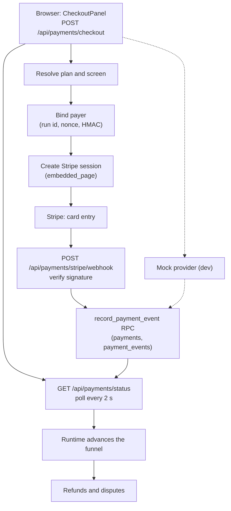
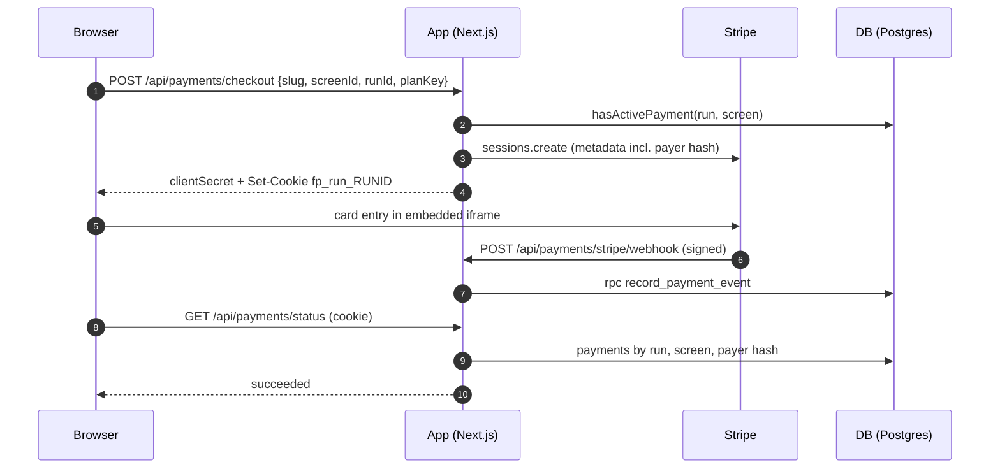

# Checkout

> A visitor pays on a checkout or upsell screen through Stripe Embedded Checkout; only a verified Stripe webhook can unlock the funnel.

## What it does

A checkout or upsell screen holds a Checkout block bound to a plan key. The browser sends only ids and the plan key; the server owns the price (`PAYMENT_PLANS_JSON`), creates a one-time Stripe Checkout session in embedded mode, and binds it to the starting browser with an HMAC payer hash. Stripe reports the outcome to a signed webhook, which is recorded idempotently in Postgres. The browser polls a status endpoint and advances the funnel only after the server answers `succeeded`. For development a mock provider replaces Stripe.

## Flow

## Steps

### Step: Start checkout

`CheckoutPanel` (rendered by the Checkout block) first calls `GET /api/payments/status`; if the payment is already `succeeded` it confirms without paying, otherwise it POSTs the checkout request with the run id from the runtime and the analytics consent flag. The response is either `mode: 'embedded'` (Stripe iframe) or `mode: 'redirect'` (mock only). Requests are rate limited: 10 per minute per client (`ipLimit`) and 5 per minute per slug and run.

**Code:** `apps/web/src/app/api/payments/checkout/route.ts` (`POST`), `apps/web/src/lib/puck/CheckoutPanel.tsx`, `apps/web/src/server/payments/rate-limit.ts` (`checkRateLimit`, `clientKey`, `ipLimit`).
**Data:** none yet; reads `payments` through `hasActivePayment`.
**Failure modes:** 429 `rate_limited` with `retry-after`; 503 `not_configured` when the provider is not `ready` (needs `STRIPE_SECRET_KEY`, `STRIPE_WEBHOOK_SECRET`, `NEXT_PUBLIC_STRIPE_PUBLISHABLE_KEY`, `RUN_TOKEN_SECRET`) or the service key is missing; 400 from body validation (`parseJsonBody`); 409 `payment_exists` when a `pending` row or a non-refunded `succeeded` row exists for the run and screen (a fully refunded one allows a new purchase, see [Refunds and disputes](./40-refunds-disputes.md)); 502 `provider_error` for other Stripe failures.

### Step: Resolve plan

The server never trusts a price from the browser. `PAYMENT_PLANS_JSON` is a map of plan key to `{ title, amount (minor units), currency, stripePriceId?, solidgateProductId? }`, parsed by zod and cached per env value. `resolveCheckoutTarget` loads the published funnel by slug, requires the screen to be of type `checkout` or `upsell`, and requires a `CheckoutBlock` on it whose `planKey` equals the request.

**Code:** `apps/web/src/server/payments/plans.ts` (`parsePlans`, `loadPlans`, `getPlan`, `listPublicPlans`), `apps/web/src/server/payments/checkout-target.ts` (`resolveCheckoutTarget`, `PLAN_BOUND_BLOCKS`), `apps/web/src/app/api/payments/plans/route.ts` (studio plan selector).
**Data:** published funnel version (`getPublishedReader`); no payment tables.
**Failure modes:** 400 `unknown_plan`, 400 `invalid_screen`, 400 `plan_not_bound`, 404 `funnel_not_found`. An unset or invalid catalogue makes `getPlan` return `null`, so every plan is unknown.

### Step: Bind payer

The route draws a random 16-byte nonce and computes `payer = HMAC-SHA256(RUN_TOKEN_SECRET, runId:screenId:nonce)`. The hash goes into the Stripe metadata; the nonce is stored in the HttpOnly cookie `fp_run_<runId>` (path `/api/payments`, SameSite=Lax, Secure in production, 30 days, up to 8 nonces joined by `.`). The status endpoint recomputes hashes from the cookie nonces, so a copied return link without the cookie matches nothing.

**Code:** `apps/web/src/server/payments/run-token.ts` (`newPayerNonce`, `payerHash`, `mergeRunCookie`, `payerHashesFromRequest`, `runTokenSecret`).
**Data:** `payments.payer_hash` is filled later by the webhook.
**Failure modes:** `RUN_TOKEN_SECRET` shorter than 16 characters gives 503 `not_configured`. A visitor who switches browser or clears cookies loses access to the paywall result for that run.

### Step: Create Stripe session

`StripeProvider.createCheckout` builds a one-time line item. With `stripePriceId` it first fetches the price and checks that it is active, not recurring, and equal to the catalogue amount and currency; without it uses inline `price_data`. It then creates a session with `mode: 'payment'`, `ui_mode: 'embedded_page'`, a 31-minute expiry, `return_url` = `<origin>/f/<slug>?run=&screen=&session_id={CHECKOUT_SESSION_ID}` (custom domain origin and `/` path when the checkout began on a tenant host) and metadata `funnelId, screenId, runId, planKey, projectId, payer, analytics` copied to both the session and the PaymentIntent. The API version is pinned in `STRIPE_API_VERSION`.

**Code:** `apps/web/src/server/payments/stripe-provider.ts` (`createCheckout`, `verifyPrice`), `apps/web/src/server/public-origin.ts` (`customDomainOrigin`, `platformRequestOrigin`), `apps/web/src/server/payments/registry.ts` (`getPaymentProvider`).
**Data:** none written; Stripe holds the session.
**Failure modes:** 502 `recurring_price_unsupported`, 502 `plan_price_mismatch` (logged), 502 `provider_error`; 503 when no origin can be determined (`APP_URL` is required in production).

### Step: Verify webhook

Stripe POSTs signed events to the webhook route (body limit 1 MiB, 413 above). `verifyWebhook` runs `stripe.webhooks.constructEvent` on the raw body with `STRIPE_WEBHOOK_SECRET`. Handled types: `checkout.session.completed` (succeeded only when `payment_status` is `paid`, else pending), `async_payment_succeeded`, `async_payment_failed`, `expired` (failed with reason `expired`), plus the refund and dispute events covered on the sibling page. Other types and sessions without our metadata are acknowledged with 200 and ignored. For payment events it re-checks funnel, project, plan, `amount_total` and currency against the catalogue; any mismatch is stored as `failed` with a reason and logs `PAYMENT_NEEDS_ATTENTION`.

**Code:** `apps/web/src/app/api/payments/stripe/webhook/route.ts`, `apps/web/src/server/payments/webhook.ts` (`processWebhook`), `apps/web/src/server/payments/stripe-provider.ts` (`verifyWebhook`, `toPaymentEvent`).
**Data:** reads `funnels.project_id` through `getFunnelProjectId`.
**Failure modes:** a missing or bad signature gives 400 `invalid_signature` (nothing stored); missing env or service key gives 503; other errors give 500 so Stripe retries with backoff. Rotation: the code reads only `STRIPE_WEBHOOK_SECRET`. `STRIPE_WEBHOOK_SECRET_PREVIOUS` appears in env files but is not read anywhere in `apps/web/src`, so a rotation needs a redeploy with the new secret and in-flight events signed with the old one are rejected with 400.

### Step: Record payment

`recordVerifiedEvent` calls `store.recordEvent`, which in Supabase mode runs the service-role RPC `record_payment_event`. The RPC takes an advisory lock on `provider:run_id`, inserts the event id into `payment_events` (a repeat returns `false` and nothing else happens), upserts into `payments` on `(provider, provider_ref)` (a row moves only from `pending` to a final state; `payer_hash` and `provider_payment_id` are filled once), then runs `apply_deferred_adjustments` for waiting refunds. After a fresh `succeeded` event it counts succeeded rows for the run and screen and logs `PAYMENT_NEEDS_ATTENTION duplicate_payment` when more than one exists. If the visitor granted consent (`analytics = 1`) it emits `payment_succeeded` or `payment_failed` (not for expiry) with a deterministic UUID. File mode uses `FilePaymentStore` (`.data/payments.json`).

**Code:** `apps/web/src/server/payments/webhook.ts` (`recordVerifiedEvent`), `apps/web/src/server/payments/supabase-payment-store.ts` (`recordEvent`, `countSucceeded`), `apps/web/src/server/payments/file-payment-store.ts`, migrations `20261027140000_payments.sql`, `20261030140000_payment_payer.sql`, `20261030180000_payment_intent_match.sql`, `20261030210000_deferred_adjustments.sql`, `20261030220000_adjustment_locks.sql`.
**Data:** `payments` (status, reason, amount, currency, plan_key, payer_hash, provider_payment_id), `payment_events` (provider, event_id), `payment_orphans` via deferred adjustments. RLS: only project members can SELECT `payments`; the RPC is granted to `service_role` only.
**Failure modes:** a non-UUID `projectId` is rejected before the RPC (`invalid_project_id`, 200 with `rejected`); RPC errors throw and give 500, so Stripe retries and the event id keeps the retry safe; a replay returns 200 `duplicate: true`.

### Step: Poll status

`GET /api/payments/status?runId=&screenId=[&ref=]` reads the payer hashes from the cookie and asks the store for the payment. It returns `pending` when there is no cookie or no matching row yet; `processing` when a pending row is found; `succeeded`; `failed`; `needs_review` (failed with a funnel, project, plan, amount or currency reason); and `refunded` or `disputed` (see the sibling page). It says `pending` until the webhook lands because the browser return from Stripe and the webhook are independent, and only the webhook writes the row. After a Stripe return the panel polls every 2 s for up to 60 s, then shows "processing" or a timeout. Locally the webhook needs `stripe listen --forward-to localhost:3000/api/payments/stripe/webhook`, with the printed signing secret placed in `STRIPE_WEBHOOK_SECRET`; without it the panel times out.

**Code:** `apps/web/src/app/api/payments/status/route.ts`, `apps/web/src/server/payments/types.ts` (`toPublicPaymentStatus`), `apps/web/src/server/payments/supabase-payment-store.ts` (`getStatus`), `apps/web/src/lib/payment-status.ts` (`fetchPaymentStatus`), `apps/web/src/lib/puck/CheckoutPanel.tsx` (`POLL_INTERVAL_MS`, `POLL_MAX_MS`).
**Data:** `payments` filtered by `run_id`, `screen_id`, `payer_hash in (...)` and optionally `provider` plus `provider_ref` (the `session_id` from the return URL).
**Failure modes:** 400 `invalid_query`; 429 with `retry-after` (limit 120 per minute per client, the client waits that long); 503 `not_configured`; all responses carry `cache-control: no-store`.

### Step: Advance funnel

On `succeeded` the panel calls `confirmPayment(screenId, { advance: true })`. The runtime sets `payments[screenId] = 'succeeded'` and an effect then calls `next()`, which follows the screen's outgoing edge using the shared schema rules. Payment state is never taken from the URL or from sessionStorage; on reload the runtime asks the server again.

**Code:** `apps/web/src/components/FunnelRuntime.tsx` (`confirmPayment`, advance effect), `apps/web/src/lib/puck/CheckoutPanel.tsx`, `packages/funnel-schema/src/next-screen.ts`.
**Data:** browser run state only (`apps/web/src/lib/run-state.ts`).
**Failure modes:** a `confirmPayment` for a screen that is no longer current is ignored; a funnel with no outgoing edge shows "You have reached the end of this funnel."

### Step: Mock provider

With `PAYMENTS_MOCK=true` and `NODE_ENV` not `production`, `getPaymentProvider` returns `MockProvider`. Checkout answers `mode: 'redirect'` to `/api/payments/mock/confirm`, a labelled page (still validated through `resolveCheckoutTarget`) with "Simulate successful payment" and "Simulate failure". The buttons POST to `/api/payments/mock/webhook`, which builds a `PaymentEvent` and calls `recordVerifiedEvent`, so storage, idempotency and status work as for Stripe, then redirects back with 303.

**Code:** `apps/web/src/server/payments/mock-provider.ts`, `apps/web/src/app/api/payments/mock/confirm/route.ts`, `apps/web/src/app/api/payments/mock/webhook/route.ts`.
**Data:** the same `payments` and `payment_events` rows with provider `mock`.
**Failure modes:** outside dev both routes return 404 and `MockProvider` throws `MockForbiddenError`; `RUN_TOKEN_SECRET` is still required.

## Related

- [Data flow: checkout, webhook, status](../DATA_FLOW.md#4-checkout-webhook-status)
- [Security](../SECURITY.md) and [Architecture](../ARCHITECTURE.md)
- [Feature map](./00-map.md), [Authoring](./10-authoring.md), [Runtime](./20-runtime.md)
- [Refunds and disputes](./40-refunds-disputes.md), [Custom domains](./50-custom-domains.md), [Analytics and consent](./60-analytics-consent.md), [Auth and access](./70-auth-access.md)
