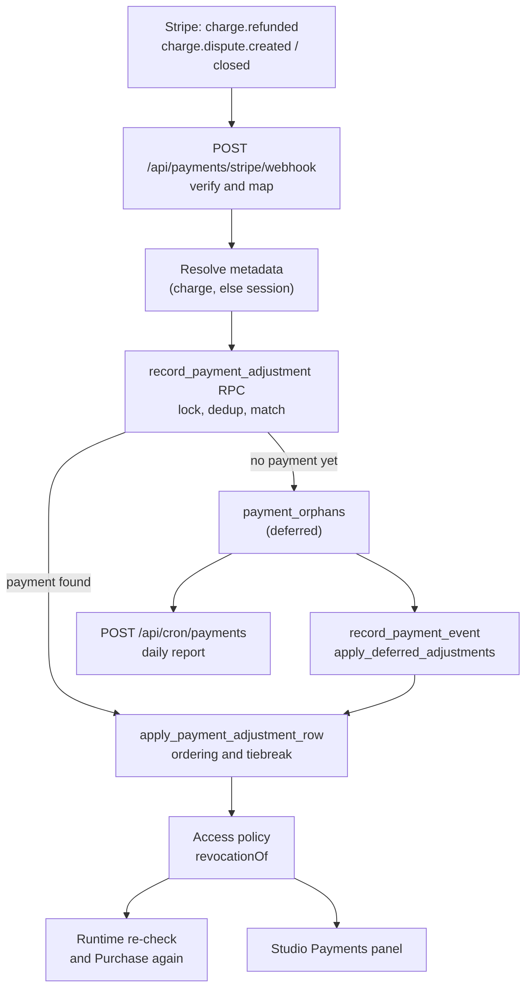
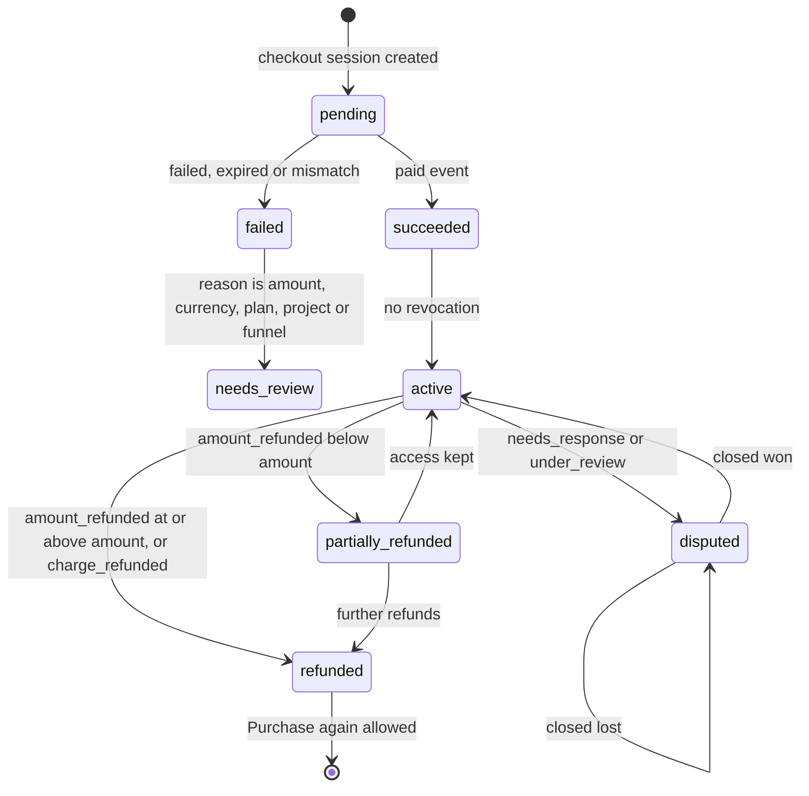

# Refunds and disputes

> Stripe refund and dispute webhooks adjust a recorded payment, and that adjustment closes or suspends the visitor's access to paid screens.

## What it does

After a payment succeeds, Stripe can send `charge.refunded`, `charge.dispute.created` and `charge.dispute.closed`. Each becomes a `PaymentAdjustment` that updates `amount_refunded` and `dispute_status` on the matching `payments` row, in event-time order, under an advisory lock. If the payment row does not exist yet the adjustment is parked in `payment_orphans` and applied when the payment arrives. Access is derived from the row (`revocationOf`): a full refund closes it, an open or lost dispute suspends it, a partial refund or a won dispute keeps it. The runtime re-checks passed payment screens, and the studio lists the latest payments with their access state.

## Flow

## Steps

### Step: Verify and map event

The same webhook route and signature check as checkout. `verifyWebhook` maps `charge.refunded` to an adjustment with `amountRefunded = charge.amount_refunded` (a cumulative total). For `charge.dispute.created` and `charge.dispute.closed` it fetches the charge by id (`charges.retrieve`) and carries `dispute.status` (kept only if it matches `^[a-z_]{1,40}$`). The adjustment carries Stripe's `event.created` as `occurredAt`.

**Code:** `apps/web/src/server/payments/stripe-provider.ts` (`verifyWebhook`, `toAdjustment`), `apps/web/src/server/payments/webhook.ts` (`processWebhook`, `processAdjustment`), `apps/web/src/server/payments/types.ts` (`PaymentAdjustment`, `isAdjustment`).
**Data:** none yet.
**Failure modes:** 400 `invalid_signature`; 503 when env or service key is missing; a failing `charges.retrieve` throws and gives 500, so Stripe retries. The webhook must be subscribed to the three charge events (see `docs/DEPLOYMENT.md`), otherwise nothing arrives.

### Step: Resolve metadata

Adjustments must be tied back to a funnel run. `adjustmentMetadata` reads `funnelId, screenId, runId, projectId, payer, analytics` from the charge metadata (copied from the PaymentIntent at checkout); if absent it lists the Checkout Session by `payment_intent` and reads the session metadata. `toAdjustment` then checks that the funnel exists and belongs to `projectId`; if not it logs `PAYMENT_NEEDS_ATTENTION` (`funnel_missing` or `project_mismatch`), still records the adjustment, but turns off analytics for it.

**Code:** `apps/web/src/server/payments/stripe-provider.ts` (`adjustmentMetadata`, `toAdjustment`, `adjustmentMetadataSchema`), `apps/web/src/server/payments/supabase-payment-store.ts` (`getFunnelProjectId`).
**Data:** reads `funnels.project_id`.
**Failure modes:** a charge that is not from a funnel checkout returns `null`: logged as ignored and answered 200 `ignored`, so Stripe does not retry.

### Step: Match payment

`record_payment_adjustment` takes a transaction advisory lock on `provider:run_id` (the same lock as `record_payment_event`, so a payment and its refund written at once cannot miss each other), then returns `duplicate` if the event id is already in `payment_events`. It finds the payment first by `provider_payment_id` (the PaymentIntent, any status, so refunds of `needs_review` rows are recorded), else by run, screen and payer hash among `succeeded` rows that have no PaymentIntent id yet.

**Code:** `apps/web/src/server/payments/supabase-payment-store.ts` (`recordAdjustment`), migrations `20261030160000_payment_adjustments.sql`, `20261030180000_payment_intent_match.sql`, `20261030210000_deferred_adjustments.sql`, `20261030220000_adjustment_locks.sql`.
**Data:** `payments` (read with `FOR UPDATE`), `payment_events` (dedup).
**Failure modes:** RPC error throws and gives 500, so Stripe retries; a duplicate event answers 200 `duplicate: true`. File mode implements the same rules in `FilePaymentStore`.

### Step: Apply adjustment

`apply_payment_adjustment_row` inserts the event id into `payment_events` (returns false on repeat) and updates the row. `amount_refunded` only grows (`greatest`). `dispute_status` and `dispute_event_at` move only forward in Stripe event time: a strictly newer event wins; on an equal timestamp the new status wins unless the stored one is final (`won`, `lost`, `warning_closed`, `charge_refunded`, `prevented`). Older dispute events are ignored, so out-of-order delivery is safe. After a recorded adjustment with consent the server emits `payment_refunded` and/or `payment_disputed` with a UUID derived from the event id.

**Code:** SQL `apply_payment_adjustment_row` in `supabase/migrations/20261030230000_dispute_tiebreak.sql`; `apps/web/src/server/payments/webhook.ts` (`emitAdjustment`).
**Data:** `payments.amount_refunded`, `payments.dispute_status`, `payments.dispute_event_at`, `payments.updated_at`; `payment_events`.
**Failure modes:** none beyond RPC errors; analytics failures never fail the webhook.

### Step: Defer adjustment

If no payment matches (the refund webhook beat the `checkout.session.completed` webhook, or retries reordered them), the RPC inserts the full adjustment into `payment_orphans` (provider, event id, PaymentIntent, run, screen, payer hash, refunded amount, dispute status, `occurred_at`) and returns `deferred`; the webhook answers 200 `deferred: true` and logs a warning. A repeat of the same event id returns `duplicate`.

**Code:** `apps/web/src/server/payments/webhook.ts` (`processAdjustment`), RPC `record_payment_adjustment` (migration `20261030210000_deferred_adjustments.sql`, table from `20261030190000_payment_orphans.sql`).
**Data:** `payment_orphans` (RLS on, no grants to anon or authenticated).
**Failure modes:** no timer or retry is needed. The earlier one-hour orphan window (`20261030200000_orphan_window.sql`) is superseded: the final RPC always defers.

### Step: Apply deferred

When `record_payment_event` writes or updates a payment it calls `apply_deferred_adjustments(payment_id)` under the same advisory lock. That function locks the payment, selects matching orphans (same provider and PaymentIntent, or, for a succeeded row with no PaymentIntent, same run, screen and payer hash), orders them by `occurred_at` then `first_seen_at`, applies each through `apply_payment_adjustment_row` and deletes the orphan.

**Code:** SQL `apply_deferred_adjustments` (migration `20261030220000_adjustment_locks.sql`), called from `record_payment_event`.
**Data:** `payment_orphans` (deleted when applied), `payments`, `payment_events`.
**Failure modes:** an orphan whose payment is never recorded (for example a checkout rejected for an invalid project id) stays and is reported by the cron step.

### Step: Access policy

`revocationOf` is the single rule, used by both stores and the status route. Disputed: `dispute_status` is `needs_response`, `under_review` or `lost`. Refunded: `dispute_status = charge_refunded`, or `amount > 0` and `amount_refunded >= amount`. Everything else keeps access: partial refunds, `won`, `warning_*` inquiries, `prevented`. `toPublicPaymentStatus` turns a `succeeded` row with a revocation into `refunded` or `disputed`. `getStatus` prefers an unrevoked succeeded row, then a pending row, then a revoked one (disputed before refunded). `hasActivePayment` lets a new checkout start after a full refund (409 `payment_exists` remains for pending, disputed and active rows).

**Code:** `apps/web/src/server/payments/types.ts` (`revocationOf`, `toPublicPaymentStatus`), `apps/web/src/server/payments/supabase-payment-store.ts` (`getStatus`, `hasActivePayment`, `rowRevocation`).
**Data:** `payments.amount`, `amount_refunded`, `dispute_status`.
**Failure modes:** a lost dispute stays closed and a new checkout is blocked; the visitor must contact support.

### Step: Runtime re-check

On a restored run (not a Stripe return) `FunnelRuntime` takes the last 5 checkout or upsell screens in history (`MAX_VERIFIED_PAYMENTS`) and calls `GET /api/payments/status` for each. If one is `refunded` or `disputed` the runtime truncates history to before that screen, restores its answers, clears payment state and puts the visitor back on that screen. `CheckoutPanel` then shows "Purchase again" after a refund (a new checkout is allowed) or a message to contact support for a dispute (a new checkout stays blocked). A re-check failure is only logged.

**Code:** `apps/web/src/components/FunnelRuntime.tsx` (verify effect, `MAX_VERIFIED_PAYMENTS`), `apps/web/src/lib/puck/CheckoutPanel.tsx` (`refunded`, `disputed` views, `repurchase`), `apps/web/src/lib/payment-status.ts`.
**Data:** browser run state; server `payments` read through status.
**Failure modes:** the check needs the payer cookie, so another browser sees `pending`; 429 or 503 leave the visitor where they were.

### Step: Studio payments panel

`PaymentsPanel` in the funnel editor loads `GET /api/funnels/[id]/payments` (studio session, `withStudio`), which returns the latest 50 payments of the funnel with provider, ref, screen, plan, amount, status, reason, `amountRefunded`, `disputeStatus` and `revoked`. It renders "Paid, access active", "Refunded, access closed" or "Disputed, access suspended", plus refunded amount and dispute status.

**Code:** `apps/web/src/app/api/funnels/[id]/payments/route.ts`, `apps/web/src/components/PaymentsPanel.tsx`, `apps/web/src/server/payments/supabase-payment-store.ts` (`listFunnelPayments`).
**Data:** `payments` filtered by `project_id` and `funnel_id`, newest first.
**Failure modes:** 404 `not_found` for a funnel outside the project; 503 `not_configured` without the service key (the panel shows "Payments are not configured on this server.").

### Step: Daily report

`POST /api/cron/payments` requires `Authorization: Bearer <CRON_SECRET>` (secret of at least 16 characters, constant-time compare). It calls `listStaleDeferred` for `payment_orphans` older than 24 hours, logs up to 200 lines `PAYMENT_NEEDS_ATTENTION <provider> event <id> has waited since <time> for a payment that was never recorded`, and returns `{ staleDeferred, logged }`. It changes no data; an operator inspects Stripe and the rows. Schedule it daily (see `docs/DEPLOYMENT.md`).

**Code:** `apps/web/src/app/api/cron/payments/route.ts`, `apps/web/src/server/cron-auth.ts` (`cronAuthorized`), `apps/web/src/server/payments/supabase-payment-store.ts` (`listStaleDeferred`).
**Data:** reads `payment_orphans` (`first_seen_at`).
**Failure modes:** 401 `unauthorized`; 503 `not_configured` without `CRON_SECRET` or the service key.

## Related

- [Data flow: refunds and disputes](../DATA_FLOW.md#5-refunds-and-disputes)
- [Security](../SECURITY.md) and [Deployment](../DEPLOYMENT.md)
- [Feature map](./00-map.md), [Authoring](./10-authoring.md), [Runtime](./20-runtime.md)
- [Checkout](./30-checkout.md), [Custom domains](./50-custom-domains.md), [Analytics and consent](./60-analytics-consent.md), [Auth and access](./70-auth-access.md)
