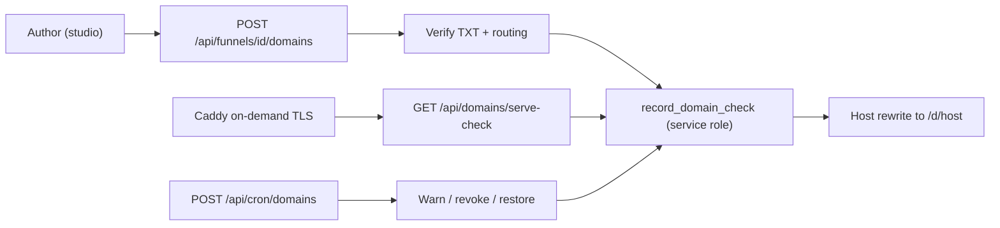
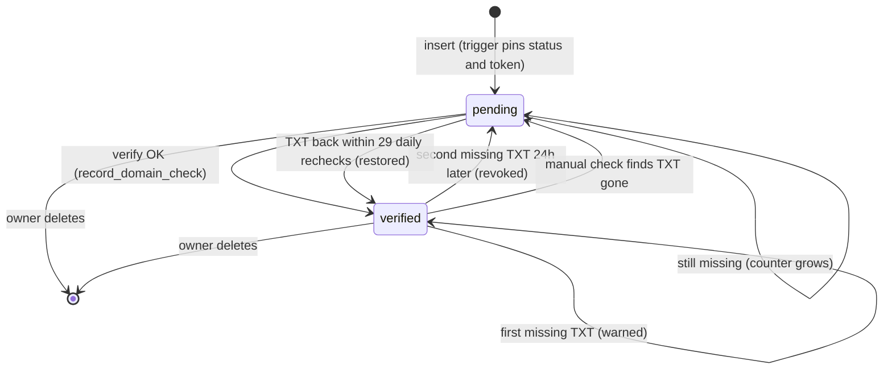

# Custom domains

> A tenant attaches their own hostname to a funnel, proves ownership with a DNS TXT record, and the platform serves, certifies and continuously re-verifies it.

## What it does

A funnel author adds a hostname in the studio. The database issues a verification token; the author publishes a TXT record at `_funnel-verify.<host>` and a CNAME (or A record) pointing at the platform. A server-side DNS lookup marks the domain verified through a service-role RPC. From then on, requests whose `Host` is that name are rewritten internally to `/d/<host>` and serve the published funnel, and Caddy may issue a TLS certificate for it after asking `serve-check`. An hourly cron job re-checks the TXT record and revokes domains whose proof disappeared.

## Flow

### Domain status

`status` only has two values (`pending`, `verified`). The warning counter is `recheck_failures`.

## Steps

### Step: Add a hostname

The studio `DomainsPanel` posts a hostname. The route normalises it, rejects platform hosts and the CNAME target (and its subdomains), then inserts a row as the user (RLS). A `BEFORE INSERT` trigger forces `status = 'pending'`, clears timestamps and generates the token (`md5(gen_random_uuid() || clock_timestamp())`).

**Code:** `apps/web/src/app/api/funnels/[id]/domains/route.ts` (`GET`, `POST`), `apps/web/src/lib/hostname.ts` (`normalizeHostname`), `apps/web/src/server/platform-host.ts` (`isPlatformHost`), `apps/web/src/server/supabase-funnel-repository.ts` (`addDomain`), `apps/web/src/server/domains/target.ts` (`domainTarget`), `apps/web/src/lib/domains.ts` (`MAX_DOMAINS_PER_FUNNEL`).

**Data:** `public.domains` (`hostname`, `funnel_id`, `project_id`, `status`, `verification_token`, `recheck_failures`); trigger `domains_guard`; policies `domains_select`, `domains_insert`, `domains_delete` via `is_project_member`. Authenticated users have no UPDATE grant.

**Failure modes:** invalid name gives 400 `invalid_hostname`; platform or target hostname gives 400 `reserved_hostname`; a sixth domain on one funnel raises SQLSTATE `54000`, mapped to 409 `domain_limit` (limit: 5 hostnames per funnel); project/funnel mismatch raises `23503`.

### Step: Verify TXT and routing

The author creates `TXT _funnel-verify.<host> = funnel-verify=<token>` and a CNAME to `CUSTOM_DOMAIN_TARGET` (default: the `APP_URL` host) or an A record to `CUSTOM_DOMAIN_TARGET_IP` for apex names, then clicks check. `checkDomainDns` resolves both in parallel with `node:dns` (5 s timeout, one try, optional resolvers from `CUSTOM_DOMAIN_DNS_SERVERS`). Only the TXT result decides ownership; routing (`ok`, `missing`, `unknown`) is advisory. An A record equal to the target IP, or sharing an IP with the CNAME target, also counts as `ok`.

**Code:** `apps/web/src/app/api/funnels/[id]/domains/[domainId]/verify/route.ts` (`POST`), `apps/web/src/server/domains/verify.ts` (`checkDomainDns`, `checkDomainOwnership`, `configuredDnsServers`), `apps/web/src/lib/domains.ts` (`txtRecordName`, `txtRecordValue`).

**Data:** reads `domains.verification_token`; nothing is written in this step.

**Failure modes:** `ENOTFOUND` or `ENODATA` means ownership `false`; timeouts, SERVFAIL and REFUSED mean ownership `null`, and the route then keeps the stored status instead of un-verifying a live domain. A bad `CUSTOM_DOMAIN_DNS_SERVERS` entry throws `DnsConfigError` (503 `not_configured`). The route allows 10 checks per minute per domain (429 with `retry-after`).

### Step: Record the check

The result is written by the service role because authenticated users cannot update `domains`. `record_domain_check(p_domain_id, p_verified, p_error)` is `SECURITY DEFINER`, executable by `service_role` only, and sets `status`, `verified_at` (kept if already set), `last_checked_at`, `last_error` (cut to 500 chars) and resets `recheck_failures` to 0.

**Code:** `apps/web/src/server/supabase-funnel-repository.ts` (`recordDomainCheck`, `releaseStaleClaim`), `apps/web/src/lib/supabase/service.ts` (`createSupabaseServiceClient`), `supabase/migrations/20261030150000_domain_recheck.sql` (current RPC body; first version in `20261030120000_domains.sql`).

**Data:** `domains.status`, `verified_at`, `last_checked_at`, `last_error`, `recheck_failures`. Partial unique index `domains_verified_hostname_idx` allows one verified row per hostname.

**Failure modes:** unique violation means another funnel holds the hostname (`DomainTakenError`, 409 `domain_taken`). Before giving up, `releaseStaleClaim` re-checks the old owner's TXT with the old token, releases that claim (`record_domain_check(false)`) only if the record no longer matches, then retries once. A missing service key gives 503.

### Step: Host-based rewrite

`proxy.ts` calls `customHost(headers)`: any `Host` that is not the `APP_URL` host, localhost or listed in `PLATFORM_HOSTS` is a tenant host. On a tenant host, `/` is rewritten to `/d/<host>`; only `/api/payments/`, `/api/health`, `/api/domains/serve-check` and `/__nextjs` pass through; everything else (studio, login, preview, funnel API) answers 404. On platform hosts `/d/*` is 404 too. The page loads the funnel through `getPublishedByHost`, which returns verified domains of published funnels only.

**Code:** `apps/web/src/proxy.ts` (`route`, `CUSTOM_HOST_PATHS`), `apps/web/src/server/platform-host.ts` (`customHost`, `requestHost`, `isPlatformHost`), `apps/web/src/app/d/[host]/page.tsx` (`CustomDomainFunnelPage`).

**Data:** read-only through `get_published_funnel_by_host` (verified and published rows only).

**Failure modes:** unknown, pending or unpublished host gives `notFound()`; a non-normalised host segment (`hostname !== host`) also 404s. If `PLATFORM_HOSTS` omits an extra platform URL, that URL is treated as a tenant host and the studio answers 404 there.

### Step: Serve-check gate for TLS

Caddy's on-demand TLS `ask` URL calls `GET /api/domains/serve-check?domain=<host>[&secret=...]`. Platform hosts answer 200. Others are normalised and looked up with `isHostServable` (`is_host_servable`: verified domain and funnel `published` with a published version). 200 means issue, 404 means refuse.

**Code:** `apps/web/src/app/api/domains/serve-check/route.ts` (`GET`, `askSecretMatches`), `apps/web/src/server/rate-limit.ts` (`checkRateLimit`, `clientKey`, `ipLimit`), Caddy file `00-funnel-domains.caddy` described in `docs/DEPLOYMENT.md`.

**Data:** `domains` joined with `funnels` through `is_host_servable` (granted to anon).

**Failure modes:** 400 `invalid_hostname`; 404 `unknown_domain`; 429 when over 120 asks per minute for one hostname, or over the per-client limit (300 per minute per IP, 600 shared when the IP is unknown). A matching `CUSTOM_DOMAIN_ASK_SECRET` (SHA-256 plus `timingSafeEqual`) skips the per-client limit but not the per-domain one.

### Step: Hourly re-verification

An operator schedules `POST /api/cron/domains` hourly with `Authorization: Bearer $CRON_SECRET`. The job claims due rows five at a time (`claim_domain_rechecks`, `FOR UPDATE SKIP LOCKED`; due means last check older than 24 h and status `verified`, or `pending` with `recheck_failures` between 1 and 29), re-checks only the TXT record, and stops after 50 domains or 45 s. The response is a JSON summary with counts per outcome.

**Code:** `apps/web/src/app/api/cron/domains/route.ts` (`POST`), `apps/web/src/server/cron-auth.ts` (`cronAuthorized`), `apps/web/src/server/domains/maintenance.ts` (`SupabaseDomainMaintenance.claimDueDomains`, `releaseClaim`, `recordRecheck`).

**Data:** `domains.last_checked_at` (set by the claim), `recheck_failures`, `last_error`.

**Failure modes:** 401 wrong bearer; 503 when `CRON_SECRET` is unset or under 16 characters, the service key is missing, or `CUSTOM_DOMAIN_DNS_SERVERS` is invalid; 500 when any lookup or write failed. A failed lookup releases the claim so the domain is retried in about an hour.

### Step: Warn, revoke, restore

`record_domain_recheck(p_domain_id, p_outcome, p_error, p_revoke_after)` receives `ok`, `missing` or `unknown`, with `p_revoke_after = 2`. `unknown` (timeouts) only updates the message. The first `missing` on a verified domain returns `warned` (counter 1, still served). The second, at least 24 h later, returns `revoked`: status becomes `pending`, so routing and `serve-check` stop. A pending row with `recheck_failures > 0` keeps being polled daily (`still_missing`); if the TXT returns within 29 re-checks it becomes `verified` again (`restored`).

**Code:** `supabase/migrations/20261030150000_domain_recheck.sql` (`record_domain_recheck`), `apps/web/src/app/api/cron/domains/route.ts` (`REVOKE_AFTER_FAILURES`).

**Data:** `domains.status`, `verified_at`, `recheck_failures`, `last_error`. Rows the owner set to pending by hand (`recheck_failures = 0`) are never touched.

**Failure modes:** restoring when another funnel verified the hostname meanwhile hits the unique index and returns `taken` (counter reset, explanatory `last_error`). After roughly four weeks the tenant must run the check manually. Revocations and restorations are logged with the hostname.

## Related

- [Data flow: custom domains](../DATA_FLOW.md#7-custom-domains) and [trust boundaries](../DATA_FLOW.md#9-trust-boundaries)
- [Security: custom domains](../SECURITY.md#custom-domains), [Deployment: custom domains and Caddy](../DEPLOYMENT.md#custom-domains-for-funnels)
- [Map](./00-map.md), [Authoring](./10-authoring.md), [Runtime](./20-runtime.md), [Checkout](./30-checkout.md)
- [Analytics and consent](./60-analytics-consent.md), [Auth and access](./70-auth-access.md)
