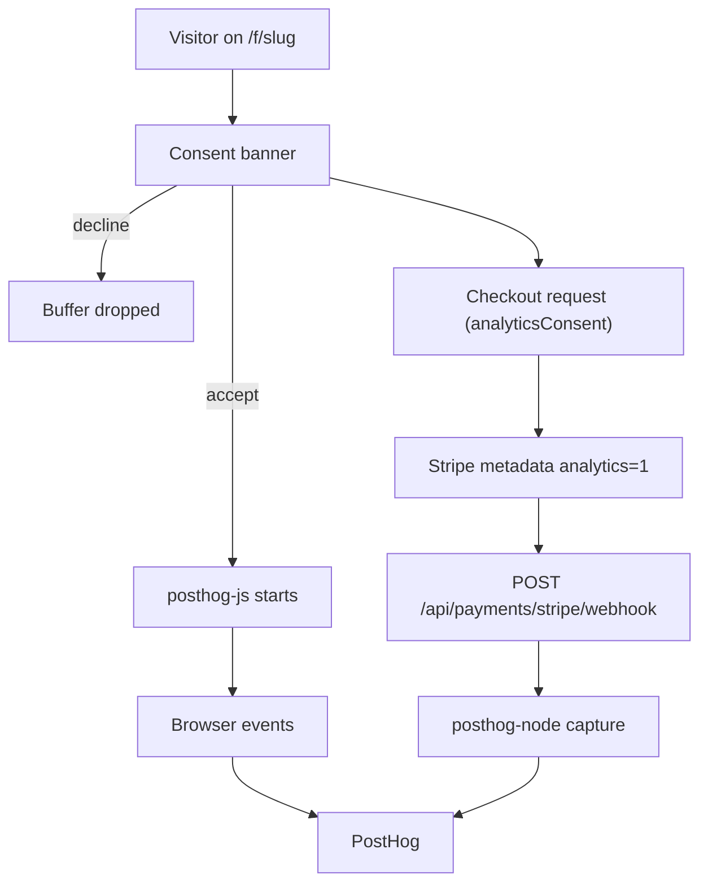

# Analytics and consent

> PostHog analytics run only after the visitor accepts a consent banner; the browser owns funnel-step events, the server owns payment events, and no personal data is sent.

## What it does

On a public funnel the visitor sees a consent banner. Nothing is sent until they accept; events raised before the decision are buffered in memory and dropped on decline. After consent, `posthog-js` starts with memory persistence (no PostHog cookie) and the funnel run id as distinct id, and reports funnel steps. Payment outcomes are reported by the server (`posthog-node`) from the verified Stripe webhook, only if the visitor consented at checkout time. Both sides share the run id, so PostHog can join them into one funnel.

## Flow

## Steps

### Step: Consent banner

`useFunnelAnalytics` is enabled only when the runtime has a slug, so the studio and the draft preview never track. On mount it reads the stored decision; with `unknown` it shows `ConsentBanner` (Accept or Decline), fixed at the bottom with a spacer of its measured height under the content so nothing stays hidden behind it; on checkout and upsell screens it switches to a one-line compact form so the payment form stays visible. `decide` stores the choice and re-runs `settle`. Events before the SDK is running go to an in-memory buffer (max 100).

**Code:** `apps/web/src/components/ConsentBanner.tsx`, `apps/web/src/lib/analytics/use-funnel-analytics.ts` (`useFunnelAnalytics`, `settle`, `BUFFER_LIMIT`), `apps/web/src/lib/analytics/consent.ts` (`readConsent`, `writeConsent`), `apps/web/src/components/FunnelRuntime.tsx`.

**Data:** `localStorage["funnel-analytics-consent"]` = `granted` or `denied`. No cookie.

**Failure modes:** unavailable `localStorage` logs a warning and reads as `unknown` (banner shows each visit). Without `NEXT_PUBLIC_POSTHOG_KEY` the hook does nothing and no banner appears. Decline empties the buffer and keeps the SDK off.

### Step: Start the browser SDK

After consent, and once the run id exists, `startBrowserAnalytics(runId)` initialises `posthog-js` with `persistence: 'memory'`, `bootstrap.distinctID = runId`, `person_profiles: 'never'`, `respect_dnt: true`, `ip: false`, and autocapture, pageviews, session recording, surveys, heatmaps, dead clicks, exception capture and feature flags all disabled. Buffered events are then flushed.

**Code:** `apps/web/src/lib/analytics/browser.ts` (`startBrowserAnalytics`, `isBrowserAnalyticsConfigured`), `apps/web/src/server/csp.ts` (`connect-src` allows `*.posthog.com` and the configured host).

**Data:** env `NEXT_PUBLIC_POSTHOG_KEY`, `NEXT_PUBLIC_POSTHOG_HOST` (default `https://us.i.posthog.com`). Nothing persisted in the browser by PostHog.

**Failure modes:** init throws or no key gives `sdk = failed`, buffer cleared, a warning logged, the funnel keeps working. Request errors only log a status code.

### Step: Browser events

The runtime calls `track` with typed events; `toProperties` turns each into an allowlisted property bag. Every event carries `source`, `project_id`, `funnel_id`, `funnel_version`, `run_id`.

| Event | Extra properties | Raised |
|---|---|---|
| `funnel_view` | none | once the run is restored |
| `screen_view` | `screen_id`, `screen_type` | each screen |
| `paywall_view` | `screen_id` | paywall screens |
| `answer_selected` | `screen_id`, `option_count`; `option_ids` only if `NEXT_PUBLIC_ANALYTICS_ANSWER_IDS=true` | on answer |
| `step_completed` | `screen_id` | on advance |
| `checkout_started` | `screen_id`, `plan_key` | checkout block click |
| `funnel_completed` | none | terminal or finish screen, once |

**Code:** `apps/web/src/lib/analytics/events.ts` (`AnalyticsEvent`, `toProperties`, `BrowserAnalyticsEvent`), `apps/web/src/lib/analytics/browser.ts` (`trackBrowserEvent`), `apps/web/src/components/FunnelRuntime.tsx`, `apps/web/src/lib/puck/CheckoutPanel.tsx` (`checkout_started`).

**Data:** sent to PostHog only; ids, never free text or emails. The answer-ids flag is read at build time (`NEXT_PUBLIC_*`).

**Failure modes:** capture errors are caught and logged. `ServerOnlyAnalyticsEvent` types make the payment events impossible to emit from the browser emitter.

### Step: Consent travels with checkout

When the visitor starts checkout, `analytics.hasConsent()` becomes `analyticsConsent` in the request. The provider stores it as metadata `analytics: '1' | '0'` on the Stripe session (or mock payment). The webhook later reads it back, so the server never needs to see the browser's `localStorage`.

**Code:** `apps/web/src/components/FunnelRuntime.tsx` (`analyticsConsent: analytics.hasConsent`), `apps/web/src/server/payments/stripe-provider.ts` (metadata `analytics`, parsed into `analyticsConsent`), `apps/web/src/server/payments/mock-provider.ts`.

**Data:** Stripe session metadata `analytics`. Absent or malformed values default to `'0'`.

**Failure modes:** metadata from an untrusted scope never enables analytics (`scopeTrusted && meta.analytics === '1'` on the verified path). No consent means no server event.

### Step: Server-side payment events

After a verified, non-duplicate webhook event (`recordVerifiedEvent`) or refund/dispute adjustment (`emitAdjustment`), and only if `analyticsConsent` is true, `serverAnalytics.emit` captures `payment_succeeded`, `payment_failed` (not for `expired` sessions), `payment_refunded` or `payment_disputed`. `distinctId` is the run id, so server and browser events join. The UUID is derived deterministically from provider, event id and name, so webhook retries do not duplicate events.

**Code:** `apps/web/src/server/payments/webhook.ts` (`recordVerifiedEvent`, `emitAdjustment`), `apps/web/src/server/payments/emitter.ts` (`serverAnalytics`), `apps/web/src/server/analytics/posthog.ts` (`posthogServerAnalytics`, `getClient`).

**Data:** payload: `payment_id`, `provider_payment_id`, `provider`, `plan_key`, `amount`, `currency`, `reason` or `charge_id`, `amount_refunded_total`, `dispute_status`, plus the common scope. `$process_person_profile: false`, `disableGeoip: true`, option ids never included. Env `POSTHOG_KEY`, `POSTHOG_HOST` (fall back to the `NEXT_PUBLIC_` pair).

**Failure modes:** no key means a silent no-op; capture errors are logged and never fail the webhook. The client uses `flushAt: 1`, 5 s timeout and 2 retries.

## What is and is not sent

Sent: event name, project, funnel, funnel version, run id, screen ids and types, option count (option ids only with the flag), plan key, payment and charge references, amounts, currency, failure reason, dispute status. Not sent: email addresses, free-text answers, IP address (disabled both sides), cookies, session recordings, autocapture data, person profiles. The studio, preview and sessions without consent send nothing.

## Related

- [Data flow: analytics and consent](../DATA_FLOW.md#6-analytics-and-consent), [Security: privacy and analytics](../SECURITY.md#privacy-and-analytics)
- [Map](./00-map.md), [Runtime](./20-runtime.md), [Checkout](./30-checkout.md), [Refunds and disputes](./40-refunds-disputes.md)
- [Custom domains](./50-custom-domains.md), [Auth and access](./70-auth-access.md)
