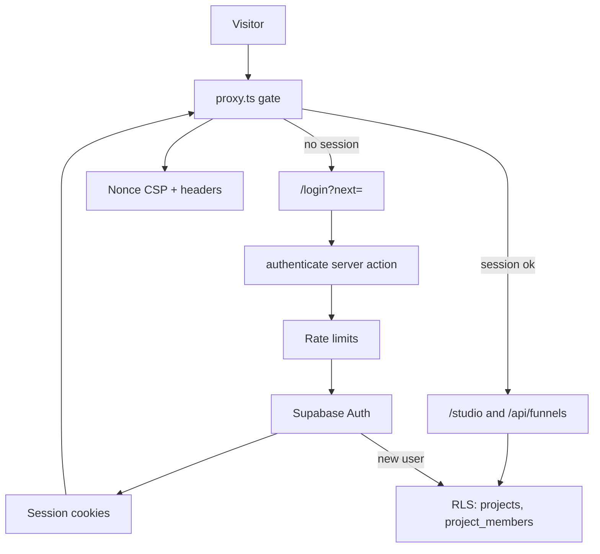

# Auth and access

> Supabase email and password auth with cookie sessions, a proxy that gates the studio, RLS-enforced project membership, and a per-request nonce CSP.

## What it does

Authors sign up and sign in on `/login` through a server action that is rate limited and talks to Supabase Auth. Sessions live in httpOnly cookies managed by `@supabase/ssr`. `src/proxy.ts` validates the session for studio, preview and funnel API paths and redirects anonymous visitors to `/login?next=...`. Every studio query runs with the user's JWT, so Postgres RLS on `projects`, `project_members` and `funnels` decides what is visible. Public funnel pages are served without a session and get their own CSP.

## Flow

## Steps

### Step: Proxy gate

For non-tenant hosts and when `FUNNEL_STORAGE=supabase`, `proxy` treats `/login`, `/studio/**`, `/preview/**`, `/api/funnels` and `/api/funnels/**` as protected and calls `updateSession`, which refreshes cookies and verifies the user with `auth.getUser()` (checked against the auth server, not just the cookie). Authenticated users hitting `/login` are redirected to `/studio`. Anonymous page requests are redirected to `/login?next=<encoded path and query>`; anonymous API requests get 401 `unauthenticated`.

**Code:** `apps/web/src/proxy.ts` (`proxy`, `route`, `isProtected`), `apps/web/src/lib/supabase/proxy.ts` (`updateSession`, `withSessionCookies`), `apps/web/src/lib/storage-mode.ts` (`resolveStorageMode`).

**Data:** reads and refreshes Supabase session cookies.

**Failure modes:** with file storage (development) the gate is skipped. Pages and handlers check again via `getStudioContext()` (`apps/web/src/server/repository.ts`), which returns null without a user. On tenant hostnames studio and login are 404 before the gate runs (see [custom domains](./50-custom-domains.md)).

### Step: Login page and next redirect

`/login` renders `LoginForm` with the `next` query value; if a session already exists it redirects to `/studio`. `next` is re-validated on the server after login: it must start with `/`, contain no backslash or control character, and resolve to the same origin (derived from `x-forwarded-host` and `x-forwarded-proto`), otherwise `/studio` is used.

**Code:** `apps/web/src/app/login/page.tsx`, `apps/web/src/app/login/LoginForm.tsx`, `apps/web/src/app/auth/actions.ts` (`safeNext`, `requestOrigin`).

**Data:** none persisted.

**Failure modes:** open-redirect attempts (`//evil.com`, `/\evil`) fall back to `/studio`. With file storage `/login` redirects straight to `/studio`.

### Step: Sign-up, sign-in, sign-out

`authenticate` validates credentials with zod (email up to 320 chars, password 8 to 200), applies rate limits, then calls `signUp` or `signInWithPassword`. Sign-up without a returned session shows "Check your inbox to confirm your email, then sign in." (hosted projects have confirmation enabled; `supabase/config.toml` sets `enable_confirmations = false` for local dev). Success redirects to the safe `next`. `signOut` calls `auth.signOut()` and redirects to `/login`; it is a form action in the studio sidebar (`StudioShell`, shown in Supabase mode only).

**Code:** `apps/web/src/app/auth/actions.ts` (`authenticate`, `signOut`), `apps/web/src/lib/supabase/server.ts` (`createSupabaseServerClient`), `apps/web/src/components/StudioShell.tsx`.

**Data:** Supabase `auth.users`; session cookies.

**Failure modes:** messages are generic and the Supabase error is only logged: "Invalid email or password.", "Could not sign up with these details.", "Confirm your email address first, then sign in.", or "Sign-in is temporarily unavailable" for outages, 429, 5xx and a thrown network error.

### Step: Rate limits

Two in-memory `RateLimiter` stores (requests and failures) in the server action. Requests: 10 sign-ins and 5 sign-ups per minute per client; when the client IP is unknown (`TRUST_PROXY_HOPS` unset) one shared cap of 300 sign-ins and 60 sign-ups per minute. Failures: a slot is reserved before calling Supabase (cap 50 per hour per account, and 10 per 15 minutes per account and client when the IP is known) and released unless Supabase answers with a real credential failure. Successful sign-ins, outages, 429s and unconfirmed emails never count.

**Code:** `apps/web/src/app/auth/actions.ts` (`requestBlocked`, `reserveSignInFailure`, `releaseSignInFailure`, `isNonCredentialError`), `apps/web/src/server/rate-limit.ts` (`RateLimiter`, `clientKeyFromHeaders`).

**Data:** process memory only; counters reset on restart and are per instance.

**Failure modes:** over limit returns "Too many attempts. Please wait a few minutes and try again." and logs a warning. Many addresses can lock one account for up to an hour (accepted cost). The proxy must overwrite `X-Forwarded-For` or `CLIENT_IP_HEADER`.

### Step: Session cookies

Both the proxy client and the server-action client use `SESSION_COOKIE_OPTIONS`: `httpOnly`, `sameSite: 'lax'`, `secure` in production. Server components cannot set cookies, so `setAll` ignores the read-only-context error; the proxy is where refreshed tokens are written back.

**Code:** `apps/web/src/lib/supabase/cookie-options.ts`, `apps/web/src/lib/supabase/server.ts`, `apps/web/src/lib/supabase/proxy.ts`.

**Data:** Supabase auth cookies (names managed by `@supabase/ssr`). The browser JavaScript cannot read them.

**Failure modes:** an expired or revoked session fails `getUser()`, so the proxy redirects or answers 401. `withSessionCookies` copies refreshed cookies onto redirect responses so a refresh is not lost.

### Step: Projects and RLS

The `on_auth_user_created` trigger runs `handle_new_user()`: it creates a project named "My project" and adds the user to `project_members` as `owner`. Roles are `owner` and `editor`. RLS is enabled on all tables; `is_project_member(p)` and `is_project_owner(p)` are `SECURITY DEFINER` helpers.

| Table | select | insert | update | delete |
|---|---|---|---|---|
| `projects` | member | none (signup trigger) | owner | owner |
| `project_members` | member | owner | owner | owner |
| `funnels` | member | member | member | owner |

Drafts, publish and rollback go through RPCs (`save_draft`, `publish_funnel`, `rollback_funnel`) that re-check membership; a trigger refuses deleting or demoting the last owner. `domains` and payment tables follow the same member-based pattern.

**Code:** `supabase/migrations/20261027120000_init.sql` (tables, policies, triggers), `apps/web/src/server/supabase-funnel-repository.ts` (`SupabaseFunnelRepository`, built with the user JWT), `apps/web/src/server/repository.ts` (`getStudioContext`).

**Data:** `projects`, `project_members`, `funnels`, `funnel_versions`, `auth.users`.

**Failure modes:** a non-member sees zero rows, and RPCs answer `P0002` (mapped to 404) for both missing and foreign funnels so ids cannot be probed; direct writes that bypass RPCs raise `42501` (treated as not found). The service role is used only for payments and domain status, never for studio CRUD. Known limitation: deleting the only owner's user leaves an orphan project.

### Step: Nonce CSP and security headers

For every non-API request `proxy` creates a nonce (`createNonce`), builds the policy with `contentSecurityPolicy(nonce, isPrivatePage)` and sets it on the forwarded request (`x-nonce`) and on the response. `script-src 'self' 'nonce-...' 'strict-dynamic'` (plus `'unsafe-eval'` in development), `connect-src` allows Stripe and PostHog, `object-src 'none'`, `base-uri 'self'`, `form-action 'self'`. `frame-ancestors` is `'none'` on `/login`, `/studio` and `/preview`, `'self'` on public pages. `next.config.mjs` adds `X-Content-Type-Options`, `Referrer-Policy`, `Permissions-Policy` everywhere, `X-Frame-Options: DENY` on studio, login, preview and API, a locked-down CSP on API routes, and HSTS in production.

**Code:** `apps/web/src/proxy.ts` (`proxy`, `isPrivatePage`), `apps/web/src/server/csp.ts` (`createNonce`, `contentSecurityPolicy`), `apps/web/next.config.mjs` (`headers`), `apps/web/src/app/layout.tsx` (`await connection()`).

**Data:** none; the nonce is per request.

**Failure modes:** a page rendered statically would carry no nonce, hence the root layout calls `connection()` to force per-request rendering. API paths skip the nonce step and rely on the static API CSP.

### Step: Private vs public pages

Private (session required, framing denied): `/login` (only for anonymous users), `/studio/**` including `/studio/docs`, `/preview/**`, `/api/funnels/**`. Public: `/f/<slug>` (published funnels, read through the anon-callable `get_published_funnel`), `/d/<host>` via a tenant hostname (rewritten from `/`), the payment endpoints and `/api/health`. The anon key can only execute the published-funnel read functions; table privileges are revoked.

**Code:** `apps/web/src/proxy.ts` (`isProtected`, `isPrivatePage`), `apps/web/src/server/repository.ts` (`getPublishedReader`, `getStudioContext`), `apps/web/src/app/f`, `apps/web/src/app/preview`.

**Data:** `get_published_funnel(slug)` returns only funnel id, project id, version and definition of a published funnel.

**Failure modes:** `/d/*` on a platform host is 404; unknown slugs 404. In production only `FUNNEL_STORAGE=supabase` is accepted, so auth cannot silently be off.

## Related

- [Data flow: authentication](../DATA_FLOW.md#8-authentication) and [trust boundaries](../DATA_FLOW.md#9-trust-boundaries)
- [Security: auth, RLS, public read](../SECURITY.md#stage-3-implementation-auth-rls-public-read), [response headers](../SECURITY.md#response-headers)
- [Map](./00-map.md), [Authoring](./10-authoring.md), [Runtime](./20-runtime.md), [Checkout](./30-checkout.md), [Refunds and disputes](./40-refunds-disputes.md)
- [Custom domains](./50-custom-domains.md), [Analytics and consent](./60-analytics-consent.md)
