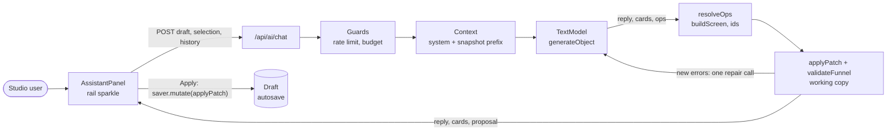

# AI assistant

> The editor chat: the manager asks for a change, the model answers with a short reply, generative UI cards and a list of edit operations; our code turns the operations into a validated patch that the manager applies or discards. Shares the provider adapters, budget, element list and screen builder with [AI generation](./81-ai-generation.md).

## What it does

The sparkle button on the editor rail opens a chat panel in place of the inspector. A manager writes "make a 6-question weight-loss quiz with a paywall" or "make this screen shorter". The model reads a compact snapshot of the draft and answers in one structured JSON:

- **reply**: one to three sentences.
- **cards** (generative UI): the model never writes HTML or JSX. It picks a card kind and fills its JSON; the editor renders it with its own components: a plan of screens, a choice to click, theme palettes, live validation issues, links to screens.
- **ops**: edit operations (add, rewrite or remove screens, change texts of the selected screen, add or remove connections, start screen, theme). The server resolves them into a `FunnelPatch` with real ids, applies it to a copy of the draft and validates it. The manager sees a proposal card with **Apply / Discard**; Apply runs through `saver.mutate`, so autosave, revisions, conflicts and publish work as for manual edits.

## Flow

## Steps

### Step: Chat panel

`AssistantPanel` keeps the messages in React state while the editor is open (closing the panel keeps them; New chat clears them). On send it posts the current draft definition from the saver, the selection (screen id when the context chip is on, and the selected Puck element id), the last 12 turns as plain text (an assistant turn carries a note like `[proposal applied: +3 screens]`) and the message. Stop aborts the request. Cards come from `cards.tsx`: `plan`, `choice` (a click sends the option as the next message), `theme` (a click applies the palette at once as a `set_theme` patch), `issues` (live validation, click selects the screen), `screens` (links). The proposal card lists the summary, shows blocking errors (Apply disabled) or the number of warnings, and records Applied or Discarded. Apply calls `applyAssistantPatch` in `FunnelEditor`: deselect, `mutate(d => applyPatch(d, patch))`, remount the open screen. When no chat model is configured (`aiChatEnabled()` from the page, no request) the composer is disabled with a note.

**Code:** `apps/web/src/components/assistant/AssistantPanel.tsx`, `cards.tsx`, `AssistantPanel.module.css`; `applyAssistantPatch` in `components/FunnelEditor.tsx`.
**Data:** messages in React state only; nothing is stored on the server.
**Failure modes:** errors use the shared AI error texts (`components/ai/errors.ts`) and appear as a red assistant line that is left out of later history; a proposal made against an older draft is applied to the current one, and the normal autosave validation and conflict banner apply.

### Step: Chat route

`POST /api/ai/chat` validates `{ funnelId, definition, selection, history, message }` (2 MB max, the definition through `funnelDefinitionSchema`), opens an AI session for the funnel (feature `chat`, 30 requests per minute, project budget) and returns JSON `{ reply, cards, proposal }`. There is no streaming: one structured call answers the whole turn.

**Code:** `apps/web/src/app/api/ai/chat/route.ts`, `runChat` in `apps/web/src/server/ai/chat.ts`.
**Data:** reads only the request; writes `ai_usage`.
**Failure modes:** 400 for an invalid body or draft, 404 for a funnel the user cannot read, 429 for rate limit or budget, 503 when not configured, 422 or 502 for model errors.

### Step: Context

The system prompt is fixed (funnel rules, ops and card semantics, the shared element guide `ELEMENTS_GUIDE`) and cached by the provider. The `prefix` holds the draft snapshot (screen ids, types, titles, first headline, element types, answer options with ids, edges with conditions, theme colors) and the configured payment plans; it stays the same across the turn and its repair call, so the repair reads it from cache. The prompt holds the history, the selected screen's text fields as `f1`, `f2`... (the focused element marked) and the message.

**Code:** `snapshot`, `runChat` in `server/ai/chat.ts`; `ELEMENTS_GUIDE` in `server/ai/brief.ts`.
**Data:** the draft sent by the browser.
**Failure modes:** a very large draft makes a large prefix; only one screen's texts are sent in full.

### Step: Operations

The answer schema is `assistantAnswerSchema` in `@funnel/schema`. It is shaped by provider limits measured on 2026-11-05: Anthropic structured outputs reject more than 16 union-typed parameters ("too many parameters with union types") and reject large grammars ("compiled grammar is too large"); a list of cards and a list of ops that are both discriminated unions is already too large. So every op is one flat object (`op` plus all fields; unused fields are empty strings, empty lists, `when: "always"`, `font: "keep"`), cards stay a small union, and there are no nullable fields. A `screen` op does not carry the screen content: it has a kind, title, question and a short `content` description. `resolveOps` turns ops into `PatchOp`s: `screen` with an empty `screenId` adds a screen built with the brief's `buildScreen` (new id `screen_<ref>_<random>`, placed in a new column; `after` inserts it into an existing connection); with an existing `screenId` it rebuilds that screen and keeps the given option ids. `set_texts` maps `f1`... to text edits, `add_edge` with `answer` checks the option belongs to the source screen (a new screen's option id is `opt_<key>`) and picks `answer_equals` or `answer_includes`, `set_theme` accepts only 6-digit hex colors. References to unknown ids are collected as problems.

Screen content is written in a second step, only for `screen` ops and only after the structure passed the checks: one call per screen with the brief's `SCREEN_SYSTEM` and `screenBlueprintSchema` (four at a time, same cached snapshot prefix). A screen whose call fails keeps the title-only fallback content and the error is logged as `[ai] chat screen`.

**Code:** `resolveOps` in `server/ai/chat.ts`; `assistantAnswerSchema`, `assistantOpSchema`, `assistantCardSchema` in `packages/funnel-schema/src/assistant.ts`; `buildScreen` in `packages/funnel-schema/src/brief.ts`.
**Data:** none.
**Failure modes:** unknown ids and invalid options become problems that block Apply unless the repair call fixes them.

### Step: Working copy

`applyPatch` in `packages/funnel-schema/src/patch.ts` is the same pure function on the server and in the browser. Ops: `add_screen` (with `insertAfter` rerouting the always/default connection), `replace_screen` (keeps the position), `remove_screen` (reconnects incoming edges to the single next screen, drops edges that use its answers), `add_edge`, `remove_edge`, `set_start_screen`, `set_theme`, `set_texts`. The server applies the patch, runs `funnelDefinitionSchema` and `validateFunnel` (save level) and counts only errors that the draft did not already have. If there are problems or new errors, one repair call sends them back to the model; its answer is used when it has no more failures than the first. Warnings travel with the proposal; `summarizePatch` writes the summary lines.

**Code:** `packages/funnel-schema/src/patch.ts`, `check` in `server/ai/chat.ts`.
**Data:** in memory.
**Failure modes:** a proposal that still has errors is shown with Apply disabled.

## Deviations from the first design

- One structured call per turn (plus at most one repair call, plus one call per added or rewritten screen) instead of a streaming tool loop: fewer model calls and no re-sending of the whole context per tool step, and it works the same on Anthropic, OpenAI and Gemini.
- No `get_screen` tool: the snapshot plus the selected screen's texts are in the request.
- No thread tables: history lives in the panel and is sent as text, so the server stays stateless and makes no extra queries.
- `metrics` and live `screen_preview` cards are not built; `screens` links to screens instead.

## Security

- Funnel content is data in the prompt. The model acts only through schema-checked ops that our code resolves; it cannot set ids, Puck JSON, URLs or markup, and image props still pass `isHttpsUrl`.
- The draft comes from the browser, but nothing is saved by the route: changes reach storage only through Apply and the normal autosave validation, under the user's own access (RLS).
- Cost: per-user rate limit, per-project daily budget, `maxTokens`, at most two structure calls per turn plus one call per added or rewritten screen, abort on Stop. Measured on Claude Haiku 5.5: a text edit, a new screen and a theme suggestion cost about $0.002 together.
