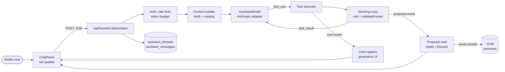
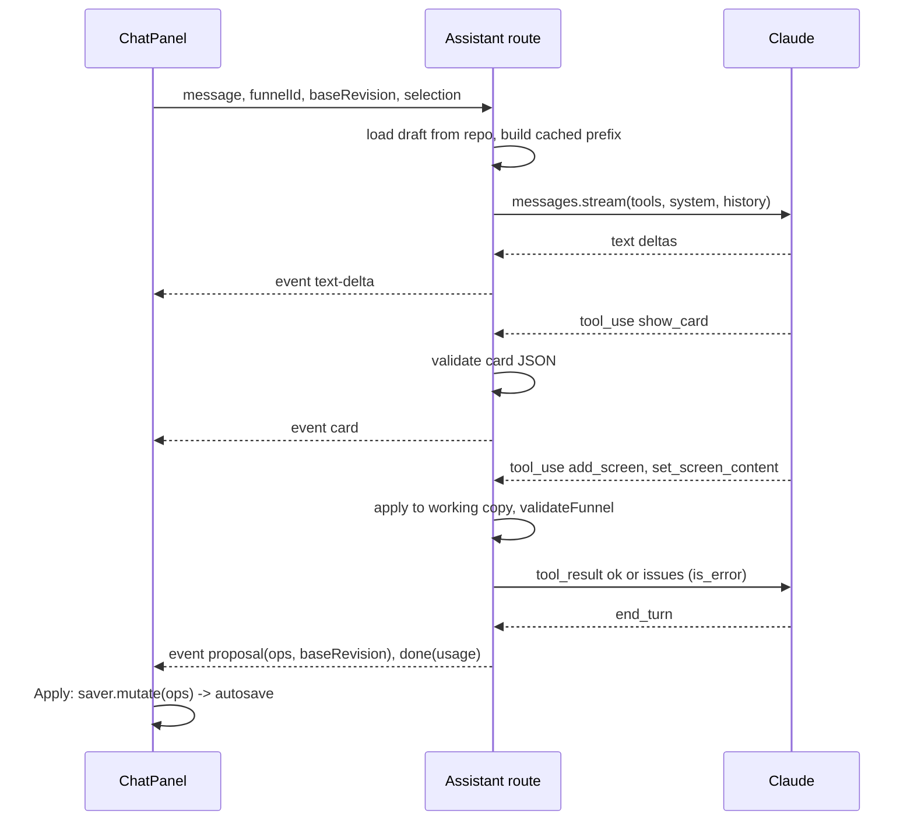

# AI assistant (design)

> Design for the editor chat: how the model is connected, how it edits the funnel through validated patches, and how it answers with generative UI cards. The chat panel UI is built with example replies; the model, route and storage are not implemented yet.

## What it does

The sparkle button on the editor rail opens a chat panel. A manager writes "make a 6-question weight-loss quiz with a paywall" or "make this screen shorter". The model reads the draft and answers in two ways:

- **Generative UI cards.** The model never writes HTML or JSX. It calls a `show_card` tool with JSON that matches one of our card schemas, and the client renders it with our own components: screen previews, choices to click, a plan outline, theme swatches, validation issues. The output stays inside the editor's design system and cannot run code.
- **Patch proposals.** The model calls mutation tools (`add_screen`, `set_screen_content`, `add_edge` and so on). The server applies them to a working copy of the draft and validates every step with the same zod schema and `validateFunnel` that guard autosave. The client receives a proposal with a diff card and **Apply / Discard** buttons. Apply runs through `saver.mutate`, so autosave, revisions, conflicts and publish work as they do today. The assistant never writes to storage itself.

## Flow

## Steps

### Step: Chat panel

The rail sparkle (`MagicIcon` in `FunnelEditor`) toggles a chat panel that takes the place of the right inspector; the inspector stays mounted underneath so Puck field portals survive, and the chat keeps its messages while closed. The panel sends the user text, the funnel id, the saver's server revision and the current selection (`selectedId`, Puck element id) so "make this shorter" has a target. It reads the SSE stream and renders text, cards and proposals in one message list. Card answers ("pick a tone": three buttons) go back as the next user message with a structured payload, not as free text.

**Built (UI preview):** `apps/web/src/components/assistant/AssistantPanel.tsx`: empty state with suggestions, message list, context chip for the selected screen, autosizing composer (Enter sends, Shift+Enter new line), stop button, and the card kinds `plan`, `choice`, `theme`, `issues` (live validation results, click selects the screen) and `proposal` (Apply and Discard disabled). Replies come from a local `demoReply` keyword matcher, and a banner says the assistant is not connected.
**Code (planned):** `useAssistantStream.ts` replacing `demoReply`, cards split into `cards/*.tsx`.
**Data:** messages in React state; the thread id in the URL query so a reload resumes the thread.
**Failure modes:** stream drops mid-answer, then the panel shows a retry that resends the last user message with the same `clientMessageId` (the route deduplicates); the draft changed since `baseRevision`, then the proposal card shows "Draft changed" and offers to re-run.

### Step: Assistant route

`POST /api/funnels/:id/assistant` is a Node runtime route that returns `text/event-stream`. Event types: `text-delta`, `card`, `proposal`, `tool-status` (for "Adding 3 screens..."), `error`, `done` with token usage. The route loads the draft from the repository itself and ignores any definition the client might send, so the model always works on the stored draft.

**Code (planned):** `apps/web/src/app/api/funnels/[id]/assistant/route.ts`, `apps/web/src/server/assistant/stream.ts`.
**Data:** reads `funnels.draft_definition`; writes thread rows.
**Failure modes:** model 429 or 5xx after SDK retries, then an `error` event with a retry hint; client disconnect aborts the model stream through `AbortSignal`, so no tokens are spent on a closed tab.

### Step: Guards

`getStudioContext` as on every studio route, then a per-user rate limit (the existing limiter) and a daily token budget per project (sum of `usage` stored on assistant messages). The model key lives only in server env (`ANTHROPIC_API_KEY`); nothing model-related reaches `NEXT_PUBLIC_*`.

**Code (planned):** `apps/web/src/server/assistant/guards.ts`.
**Data:** `assistant_messages.usage`.
**Failure modes:** budget exceeded returns 429 with `budget_exhausted` before any model call; no key configured returns 503 `assistant_not_configured`, and the sparkle stays disabled (the editor asks `/api/health` style capability flags).

### Step: Context builder

The request has three parts, in this order so prompt caching works (the cache is a prefix match: tools, then system, then messages):

1. **Tools**, sorted and generated once per deploy from code.
2. **System prompt, frozen:** role, the rules of funnels (start screen, conditions per screen type, payment screens), and the **component catalog**: for each screen type the allowed Puck components and their props as JSON Schema, generated from `configForScreenType`, `allowedComponentsForScreenType` and the zod schemas (`z.toJSONSchema`). `cache_control` goes on the last system block.
3. **Messages:** the thread history, then a compact snapshot of the draft (ids, titles, types, edges, theme; block content only for the selected screen) as the newest user turn. Full content of other screens is fetched on demand with `get_screen`, which keeps the prefix small and stable.

Volatile data (time, revision, selection) goes only into the last user turn, never into the system prompt.

**Code (planned):** `apps/web/src/server/assistant/context.ts`, `catalog.ts`.
**Data:** draft definition, Puck config.
**Failure modes:** a catalog change invalidates the cache once per deploy, which is expected; `usage.cache_read_input_tokens` staying at zero across turns means a silent invalidator and is logged.

### Step: Model adapter

An `AssistantModel` interface, like `PaymentProvider`, keeps the route provider-neutral: `stream({ system, tools, messages, signal }) -> AsyncIterable<AssistantEvent>`. The first adapter uses `@anthropic-ai/sdk` with `client.messages.stream(...)`:

- Model from `ASSISTANT_MODEL`, default `claude-opus-5-5`. Thinking is adaptive (always on for this model); depth is controlled with `output_config.effort`: `low` for chat turns, `medium` when the turn edits several screens.
- Refusal fallback on by default: beta `server-side-fallback-2026-07-01` with `fallbacks: "default"`; `stop_reason: "refusal"` still becomes an `error` event.
- `max_tokens` around 32000 with streaming; `max_tokens` and `refusal` stop reasons are checked before running any tool.
- Every tool is `strict: true` with `additionalProperties: false`, and `eager_input_streaming: true` so a card's skeleton can render while its JSON streams. Each tool input is validated again with zod before it runs, because eager streaming can hand over truncated input.
- `tool_choice` stays `auto`; forced tool choice is not available on this model, so the prompt names the tool to use.
- Errors are typed SDK classes (`RateLimitError`, `APIError`), not string matching.

**Code (planned):** `apps/web/src/server/assistant/model.ts`, `anthropic-model.ts`.
**Data:** none.
**Failure modes:** refusal, rate limit, truncated tool input (returned to the model as an `is_error` tool result so it re-issues the call).

### Step: Tools

Three groups, one loop on the server (at most 8 model turns per user message):

| Group | Tools | Executes |
|---|---|---|
| Read | `get_screen`, `list_components`, `get_funnel_stats` | reads the draft, catalog, studio overview numbers |
| Mutation | `add_screen`, `update_screen`, `remove_screen`, `set_screen_content`, `add_edge`, `remove_edge`, `set_start_screen`, `set_theme` | applies one patch op to the working copy |
| UI | `show_card` | validates the card and emits a `card` event |

Parallel tool calls are allowed; all results go back in one user message, failed ones with `is_error: true`.

**Code (planned):** `apps/web/src/server/assistant/tools/*.ts`, ops in `packages/funnel-schema/src/patch.ts` so the client and server share them.
**Data:** working copy only.
**Failure modes:** an op that references a missing screen or breaks the schema returns the issues to the model, which fixes them in the next turn; the loop limit ends the turn with a partial proposal and says so.

### Step: Working copy

A `FunnelPatch` is a list of ops (`{ op: 'add_screen', screen }`, `{ op: 'add_edge', edge }`...) in `@funnel/schema`. The server applies ops to a copy of the draft with the same pure function the client will use, then runs `funnelDefinitionSchema` and `validateFunnel` (save level). Errors go back to the model; warnings travel with the proposal. New ids come from the server, not the model.

**Code (planned):** `packages/funnel-schema/src/patch.ts` `applyPatch`, reuse of `validateFunnel`.
**Data:** in memory.
**Failure modes:** the model loops on the same invalid op, then the loop limit stops it and the proposal is dropped with an explanation.

### Step: Generative UI cards

`show_card` takes a discriminated union, each kind a zod schema in `@funnel/schema`:

| Kind | Renders | User action |
|---|---|---|
| `screen_preview` | live mini phones of given screen ids (same renderer as the canvas) | open the screen |
| `plan_outline` | the screens and connections the model intends to create | Confirm or edit before mutations run |
| `choice` | question with 2 to 6 options | click sends the option back |
| `theme_swatches` | 2 to 4 palettes | click applies via `set_theme` proposal |
| `issues` | validation issues with links to screens | select screen |
| `metrics` | leads, conversion, revenue for this funnel | none |

The client keeps a registry `kind -> component`. An unknown kind or invalid payload renders nothing and is logged. Text the model writes inside cards is shown as plain text, never as HTML.

**Code (planned):** `packages/funnel-schema/src/assistant-cards.ts`, `apps/web/src/components/assistant/cards/`.
**Data:** card payloads stored with the assistant message.
**Failure modes:** schema drift between deploys: stored cards that no longer parse are shown as "card unavailable".

### Step: Proposals

At the end of a turn the route emits one `proposal` with the ops, `baseRevision`, warnings and a preview definition. The card lists what changes ("+3 screens, 4 connections, theme") with a canvas preview. **Apply** runs `saver.mutate(d => applyPatch(d, ops))` only when the saver's server revision still equals `baseRevision`; otherwise it re-applies the ops to the newer draft and shows issues if they no longer fit. One proposal is one mutate, so a later assistant-level undo can restore the snapshot taken before Apply.

**Code (planned):** `apps/web/src/components/assistant/ProposalCard.tsx`.
**Data:** draft through the normal autosave ([Authoring](./10-authoring.md)).
**Failure modes:** conflict with another tab, then the normal conflict banner; Apply on a stale proposal, then a re-check as described.

### Step: Threads

`assistant_threads (id, funnel_id, owner, created_at)` and `assistant_messages (id, thread_id, role, content jsonb, usage jsonb, created_at)` with the same RLS shape as funnels. Content is stored as the full block list the API returned, append-only, because thinking and tool blocks must be sent back unchanged on the next turn. File mode keeps them under `.data/assistant/`.

**Code (planned):** migration `supabase/migrations/2026110xxxxxxx_assistant.sql`, `FunnelRepository` methods.
**Data:** two new tables.
**Failure modes:** history editing would break preserved thinking, so the UI never edits or deletes earlier turns; "start over" creates a new thread.

## Rollout

1. Chat with read tools and text only, behind `ASSISTANT_ENABLED`.
2. `show_card` with `screen_preview`, `choice`, `issues`.
3. Mutation tools and proposals with Apply.
4. `plan_outline` for whole-funnel generation, then theme and metrics cards.

## Security

- Funnel content written by users is data. The model can only act through schema-checked tools, cannot fetch URLs and cannot emit markup; image props still pass `isHttpsUrl`.
- Tenant isolation comes from the repository (RLS), so a thread can only read the funnel its owner can read.
- Cost: per-user rate limit, per-project daily token budget, `max_tokens`, loop limit, abort on disconnect.
