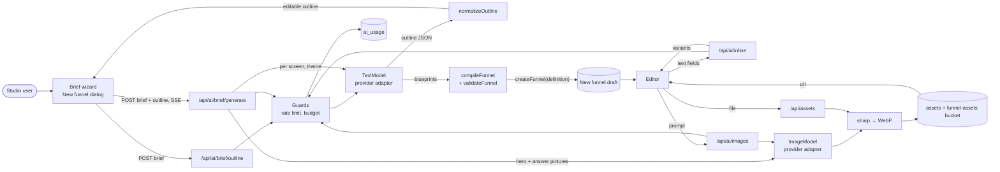

# AI generation

> A manager describes a product, AI drafts an outline they can edit, then writes every screen; our own code turns the answer into a validated funnel draft. Providers are swappable, the platform pays, and every call counts against a daily budget per project.

## What it does

In the studio, **New funnel → Generate with AI** opens a short brief: product, audience, what makes it worth it, goal (leads, subscription, one-time purchase), plans for the paywall, number of questions, tone, language, an optional brand color, an optional logo URL and, when an image model is configured, **Generate images**. The model drafts an **outline** (screens, questions, answers, branches), the manager edits it (rename, reorder, add or remove questions and answers, single or multiple choice), and **Generate funnel** writes the screens, generates the pictures and opens the new draft in the editor.

The model never writes Puck JSON, ids, edges or conditions. It returns small schema-checked structures (outline, one blueprint per screen, a theme). `compileFunnel` builds the definition deterministically: ids, option ids, edges and conditions, plan picker items from the server plan catalogue, checkout binding, positions, header and auto navigation. The result must pass `funnelDefinitionSchema` and `validateFunnel` before anything is saved.

In the editor, an **AI copy** block in the inspector rewrites, shortens, makes more persuasive, fixes or translates the text of the selected element or the whole screen, offers 3 variants, and can translate the whole funnel. The manager sees before and after and applies a variant. Every image field in the editor (Image, option images, review avatars, gallery images, video poster, screen header image, screen background, theme logo) has Upload, Generate and Library next to the URL: uploads and generated images are converted to WebP, stored per project and reusable from the library. The editor chat (see [AI assistant](./80-ai-assistant.md)) uses the same adapters, guards, element guide and screen builder (`buildScreen`).

## Flow

## Steps

### Step: Brief wizard

The New funnel dialog shows a Blank / Generate with AI switch when the page was rendered with `aiBriefOptions()` (brief model configured); the same server props carry the plan list, so the dialog makes no extra requests to open. The wizard has three steps: the brief form, the editable outline (rename screens, edit the question text and answer labels, switch one or several answers, add and remove answers (2 to 12), move a screen up or down together with its branch screens (paywall, checkout and finish stay at the end), add a question before the closing screens, remove screens, ask for a new outline), and a progress list while the screens and images are written. A logo URL must be https (checked in the browser and by `briefSchema`); `compileFunnel` sets it as `theme.logoUrl` and turns on `header.showLogo` on every screen except checkout. The Generate images checkbox appears only when the page props say an image model is configured (`aiBriefOptions().images`). Each run sends a client-made `runId`. Stop calls `POST /api/ai/brief/cancel`, which aborts the run on the server, and nothing is saved. Closing the dialog, pressing Esc or switching to Blank while screens are being written asks for confirmation first and then cancels the same way; reloading or leaving the page shows the browser leave prompt. On `done` the browser opens the new funnel in the editor.

**Code:** `apps/web/src/components/ai/BriefWizard.tsx`, `BriefWizard.module.css`, switch in `components/StudioShell.tsx`, `AI_ROUTES` in `lib/api-routes.ts`.
**Data:** brief and outline in React state; plans from server props (`aiBriefOptions` in `server/ai/registry.ts`, passed through `StudioShell`).
**Failure modes:** each error code has a readable message (`ai_not_configured`, `budget_exhausted`, `rate_limited`, `refusal`, `invalid_output`, `truncated`, `provider_error`); if the connection drops before `done` (network, reload, forced close), the server keeps going and saves the funnel as an AI draft, and the wizard says it will appear in the list.

### Step: Outline

`POST /api/ai/brief/outline` takes `briefSchema` and returns `{ outline, plans }`. The model answers in `outlineSchema` (screens of kind intro, question, info, input, loader, email, paywall, checkout, finish; options; `branchOf` for side screens). `normalizeOutline` then makes it safe to compile: unique snake_case keys, question screens without at least 2 options become info screens, branches must point to an earlier main question and an existing option, payment screens are dropped for lead funnels or when no plans are configured, and a paid funnel always ends paywall → checkout → finish.

**Code:** `apps/web/src/app/api/ai/brief/outline/route.ts`, `generateOutline` in `apps/web/src/server/ai/brief.ts`, `briefSchema`, `outlineSchema`, `normalizeOutline` in `packages/funnel-schema/src/brief.ts`.
**Data:** none stored except usage.
**Failure modes:** invalid model JSON or a schema mismatch is `invalid_output` (422); the client can ask again.

### Step: Generation

`POST /api/ai/brief/generate` takes the brief and the edited outline, normalizes the outline again (the client is not trusted), and streams Server-Sent Events: `screen` (key, ok), `theme`, then `done` with the funnel id or `error`. One call writes the theme; one call per screen writes a `screenBlueprintSchema` (CTA label, decline label, options layout, plan note, email label, elements from a fixed list of content elements plus one `Slot`). Elements come back in one flat shape (`flatElementSchema`: type, variant, text, items, entries, numbers, extra) instead of a union of element schemas, because Anthropic rejects the larger grammar; `elementFromFlat` maps each to its typed element and drops what does not fit. The brief and outline go into a shared prompt prefix (`prefix` on `GenerateObjectInput`; Anthropic marks it with `cache_control`, OpenAI and Gemini cache identical prefixes on their own). The first screen is written alone to warm that cache, then the rest run four at a time; screen and outline JSON is sent compact. a screen whose answer is invalid is asked once more (a cut-off answer is not retried), and a screen that still fails is built from its outline title so the funnel is complete. A keep-alive comment is sent every 15 seconds so proxies do not close the stream.

**Images in the brief:** with `brief.images` on, the route opens `companionImageSession`: the same project and budget as the text session (each side adds the other's spend before every call, no extra query), usage rows with feature `images`. `briefImageTargets` picks a hero for the first main screen when it is an intro or info screen, and the first question screen with 2 to 6 answers for answer pictures, so at most 7 images. They run three at a time in parallel with the screens; each is generated, converted with `toWebp` and stored by `generateAsset` (shared with `/api/ai/images`) with no funnel id, because the funnel does not exist yet, and shows up in the project's library. SSE sends `image` events with done/total/ok. `compileFunnel` inserts an Image element after the title of the hero screen and sets `image` on the answers (an answer with a picture drops its emoji, a `list` layout becomes `grid`). A failed image is skipped and the funnel is still saved; `budget_exhausted`, `quota_exhausted` and `rate_limited` stop the remaining images.

The run is not tied to the HTTP request: it is registered in an in-memory run map (`server/ai/runs.ts`) with its own abort signal, which fires on cancel or after 5 minutes. A client that disconnects does not stop it. Every generated funnel is created with `ai_draft_expires_at` = now + 7 days; opening it in the editor clears the mark (`markFunnelOpened`), so a normal run that lands in the editor keeps the funnel. Drafts that were never opened show "AI draft · deleted in N days unless opened" in the funnel list, and `withoutExpiredAiDrafts` checks the funnel rows the studio pages already loaded and only when one has expired calls `deleteExpiredAiDrafts(ids, now)`, a single delete that re-checks status and expiry (RLS limits it to owners; errors are logged and ignored), so a normal page load costs no extra query.

**Code:** `apps/web/src/app/api/ai/brief/generate/route.ts`, `apps/web/src/app/api/ai/brief/cancel/route.ts`, `apps/web/src/server/ai/runs.ts`, `generateFunnel` in `apps/web/src/server/ai/brief.ts`.
**Data:** creates the funnel through `repo.createFunnel(name, slug, groupId, definition, aiDraftExpiresAt)`; the slug is the name plus a random suffix, retried on `slug_taken`; `funnels.ai_draft_expires_at` (same migration as `ai_usage`).
**Failure modes:** budget exhausted, cancel or the 5-minute limit stops the whole run and nothing is saved; when every screen call fails the run ends with `provider_error` and nothing is saved (each failure is logged as `[ai] screen`); compile or validation errors are reported as `invalid_output` and nothing is saved; the run map is per instance, so cancel only reaches the instance that runs the generation.

### Step: Compile

`compileFunnel` maps outline kinds to screen types (intro, question, info, input, loader to `default`; email to `auth`; paywall, checkout, finish as is) and builds:

- content: the model's elements filtered by the element catalogue for the screen type (`allowedTypesFor`), the screen's own control at the `Slot` (OptionList with `opt_<key>` ids, EmailInput, PlanPicker filled from the plan catalogue with the middle plan marked "Most popular", CheckoutBlock bound to the picker or the first plan), a title if the model wrote none, an attached Continue button except on checkout, finish, single-choice questions (auto navigation) and auto-advancing loaders, and a decline button on the paywall;
- edges: `always` along the main path, `answer_equals` / `answer_includes` to branch screens with a `default` to the next main screen, paywall `always` to checkout and `default` to finish, checkout `payment_succeeded` to the next screen;
- theme: the model's colors when they are valid hex, the brand color as primary when given, font family and progress line color.

**Code:** `compileFunnel`, `screenTypeForKind` in `packages/funnel-schema/src/brief.ts`; `allowedElement` in `apps/web/src/server/ai/brief.ts`.
**Data:** in memory.
**Failure modes:** none expected; the definition is still checked with `funnelDefinitionSchema` and `validateFunnel` in save mode before saving, and warnings are counted in the `done` event.

### Step: Providers

`TextModel.generateObject({ system, prompt, schema, effort, maxTokens, signal })` turns a zod schema into a strict JSON Schema (all properties required, no extra properties, size keywords removed) and validates the answer with zod again. Adapters:

| Provider | Package | Structured output | Notes |
|---|---|---|---|
| `anthropic` | `@anthropic-ai/sdk` | `output_config.format` json_schema, streamed | `output_config.effort`, cached system prompt, server-side refusal fallback (`fallbacks: "default"`) |
| `openai` | `openai` | `response_format` json_schema strict | `reasoning_effort`; `OPENAI_BASE_URL` for compatible gateways |
| `google` | `@google/genai` | `responseJsonSchema` | `additionalProperties` stripped |

The model per feature comes from `AI_TEXT_MODEL_BRIEF` (or `AI_TEXT_MODEL` for all features) as `provider:model`, with the provider key in `ANTHROPIC_API_KEY`, `OPENAI_API_KEY` or `GOOGLE_API_KEY`. A feature is off unless the model has a price, built in for Claude models or given in `AI_PRICES_JSON`, so the budget can always be enforced. `AI_ENABLED=false` turns everything off. Each SDK is loaded only when its provider is used.

**Code:** `apps/web/src/server/ai/{types,json-schema,registry,pricing}.ts`, `apps/web/src/server/ai/providers/*.ts`.
**Data:** none.
**Failure modes:** refusal, rate limit, truncated output and provider errors become typed `AiError` codes; usage from a failed call is still recorded. A provider quota that is used up (Gemini free tier has a quota of 0 for image models) is `quota_exhausted` (429) with its own message. Provider error details go to the server log as `[ai] ...`. Measured on Claude Haiku 5.5 (2026-11-05): a 10-screen lead funnel took about 20 seconds and $0.003, with most input read from the prompt cache.

### Step: Inline copy

The element inspector shows an **AI copy** block under the element fields, and the screen inspector one for the whole screen, when the editor page was rendered with `aiInline` (`aiInlineEnabled()` on the server). Actions: Rewrite, Shorten, More persuasive, Fix errors, 3 variants, Translate into a language, and on the screen block Whole funnel. The browser collects the text fields itself from the live props (`elementTextFields`, `screenTextFields` in `packages/funnel-schema/src/text-edits.ts`): string props under a fixed list of text keys (`text`, `title`, `label`, `question`, `answer`, `placeholder`, `note` and similar), nested item lists such as list items, FAQ entries and options, and the screen header title; ids, urls, prices, styles and nested elements are left out. It sends them to `POST /api/ai/inline` as `{ funnelId, scope, action, targetLang, screenTitle, fields: [{ key, element, value }], context }`. The server renames the keys to short ids, asks the model for `{ variants: [{ fields: [{ id, value }] }] }` (1 variant, 3 for "3 variants"), maps them back and drops unknown, unchanged or empty values. The browser shows before and after; Apply on an element goes through the Puck `updateProps` command (Puck undo works), Apply on a screen or the funnel goes through `applyTextEdits` and `saver.mutate` and remounts the open screen. Whole funnel packs the text of all screens into batches of up to 120 fields and sends them in sequence, then shows one summary to apply; budget, rate limit or a missing configuration stop the loop, other failed batches are counted and their texts left as they are. Autosave and revisions work as for manual edits.

This deviates from the plan in one point: the texts come from the browser, not from the stored draft, so unsaved edits are included; the server still checks access to the funnel and the budget through `openAiSession`.

**Code:** `apps/web/src/components/ai/InlineAi.tsx`, `InlineAi.module.css`, wiring in `components/FunnelEditor.tsx` and `components/ElementInspector.tsx` (`aiSlot`); `apps/web/src/app/api/ai/inline/route.ts`, `apps/web/src/server/ai/inline.ts`; `packages/funnel-schema/src/text-edits.ts`.
**Data:** nothing stored except `ai_usage` rows (feature `inline`); the applied text is saved by the normal draft autosave.
**Failure modes:** translate without a language is 400; no text gives "Nothing to change here."; model errors use the shared `AiError` codes and messages (`components/ai/errors.ts`); rate limit for inline is 60 requests per minute per user.

### Step: Images and assets

`ImageField` (`components/ai/ImageField.tsx`) replaces the plain URL input on every image prop: Puck fields through `imageField(label, aspect)` in `lib/puck/image-field.tsx` (loaded with `next/dynamic`, so funnel visitors never download it), the header image and the logo in `FunnelEditor`, and the screen background through `ImageRow` in `ParamControls`. It keeps the URL input and adds Upload, Generate (prompt pre-filled with the screen title, aspect 1:1, 3:4, 4:3, 9:16 or 16:9) and Library. `ImageAssetsProvider` wraps the editor with the funnel id and whether generation is on (`aiImagesEnabled()`, passed by the page, no request); it loads the library once, on the first Library click, and adds new uploads and generations to that cache.

`POST /api/ai/images` takes `{ funnelId, prompt, aspect }`, runs `openImageSession` (same rate limit and budget scope as text, feature `images`: 20 per hour), calls the `ImageModel` from `AI_IMAGE_MODEL` (`google` uses `generateContent` with `responseModalities: IMAGE` and `imageConfig.aspectRatio`; `openai` uses `images.generate` with a size per aspect and WebP output), converts the result with `toWebp` (sharp: auto-rotate, fit inside 1600 px, WebP quality 82, metadata dropped) and stores it. `POST /api/assets` takes a multipart `file` (10 MB max, 60 uploads per hour per user) and `funnelId` and runs the same conversion; anything sharp cannot decode is 415 `invalid_image`. `GET /api/assets?funnelId=` lists the project's last 60 assets.

Storage: Supabase uploads with the user's own client to the public bucket `funnel-assets` at `{projectId}/{uuid}.webp`; a storage policy allows inserts only into folders of projects the user is a member of (`asset_project_id(name)` + `is_project_member`), and an `assets` row (path, size, source, prompt, model) is inserted with RLS by membership. If the row insert fails the object is removed. The public URL is https, so it passes `isHttpsUrl` and the CSP `img-src https:`. File mode writes `.data/assets/{projectId}/{uuid}.webp` and `.data/assets/index.jsonl` and serves the files from `GET /api/assets/file/{projectId}/{file}` (file mode only, strict name check). `isHttpsUrl` accepts `http://localhost` and `http://127.0.0.1` outside production so these dev URLs render; production stays https only.

**Code:** `apps/web/src/components/ai/{ImageField,ImageAssets}.tsx`, `lib/puck/image-field.tsx`, `app/api/ai/images/route.ts`, `app/api/assets/route.ts`, `app/api/assets/file/[projectId]/[file]/route.ts`, `server/assets/{process,public}.ts`, `server/ai/providers/{google-image,openai-image}.ts`, `openImageSession` in `server/ai/guards.ts`, `storeAsset` / `listAssets` on both repositories.
**Data:** `assets` table, `funnel-assets` bucket and its policies (migration `20261104120000_ai_usage.sql`); `ai_usage` rows with feature `images`.
**Failure modes:** no `AI_IMAGE_MODEL` or no price: 503 `ai_not_configured` and the Generate button is hidden; provider safety block: 422 `refusal`; no image in the answer: 422 `invalid_output`; too large: 413; not an image: 415. Generated images are not run through a separate moderation step beyond the provider's own.

### Step: Guards and budget

`openAiSession` runs inside `withStudio`: the feature must be configured (503 `ai_not_configured`), a per-user rate limit applies (brief: 10 per hour, inline: 60 per minute, images: 20 per hour), and the project's spend since 00:00 UTC must be under `AI_DAILY_BUDGET_USD` (default 5). The spend is read once per session; before every further model call the session adds its own spend to that number instead of querying again, so a long generation still stops when the budget runs out (parallel sessions of the same project can overshoot by their in-flight calls). Every call writes one `ai_usage` row with tokens, cached tokens and cost in micro-USD.

**Code:** `apps/web/src/server/ai/guards.ts`; `aiProjectId`, `recordAiUsage`, `aiSpendSince` on `FunnelRepository` (file and Supabase).
**Data:** `ai_usage` table and `ai_spend_since(project, since)` function (migration `20261104120000_ai_usage.sql`, RLS by project membership, insert only as yourself); file mode appends to `.data/ai/usage.jsonl`.
**Failure modes:** budget exhausted returns 429 `budget_exhausted`; the in-memory rate limiter resets on restart and is per instance.
