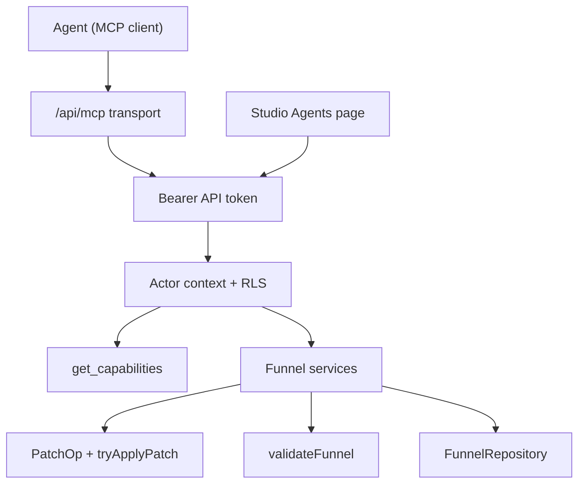

# Agent access (MCP)

> An MCP server inside every deployment: an operator's agents read, edit, validate and publish funnels with a personal API token, under the same RLS as the studio.

## Status

Built 2026-11-11. Off by default: `AGENT_ACCESS=on` turns it on, and Supabase mode also needs `SUPABASE_JWT_SECRET`. The rules for new code are in `CLAUDE.md` under "Operations contract".

Not yet exposed as tools: AI generation from a brief (long-running, paid, streams over SSE), custom domains, groups, assets. The studio editor still edits the definition directly in places instead of through `PatchOp`s.

## Principles

- **Inside the image.** MCP is a route of the same Next.js app (`APP_URL/api/mcp`, streamable HTTP). Operators get it with their deployment. Nothing runs on our infrastructure.
- **Self-contained auth.** Tokens are issued in the operator's studio and stored in the operator's database (or `.data` in file mode). No external OAuth provider.
- **Capabilities, not assumptions.** Payments, AI, analytics and custom domains are optional per deployment. The agent asks `get_capabilities` first.
- **One contract.** Tools call the same services and `PatchOp`s as the studio routes, so behaviour never forks.
- **Versioned.** Tools report `apiVersion` and `schemaVersion`. Migrations go before code, as with RPCs (see [Deployment](../DEPLOYMENT.md)).

## Flow

## Tools

| Tool | Scope | Operation |
|---|---|---|
| `get_capabilities` | read | `getCapabilities()` |
| `list_funnels` | read | `listFunnels` |
| `get_funnel` | read | `getFunnelDraft`: definition and revision |
| `validate_funnel` | read | `validateDraft`: `validateFunnel` with the plan catalogue, mode `publish` or `save` |
| `apply_patch` | write | `applyFunnelPatch`: `funnelPatchSchema`, `tryApplyPatch`, validate, save with `expectedRevision`; `dryRun` checks without saving |
| `create_funnel` | write | `createFunnel` |
| `publish_funnel` | publish | `publishFunnel`: publish validation with the plan catalogue |
| `rollback_funnel` | publish | `rollbackFunnel` |
| `list_versions` | read | `listVersions` |
| `get_leads` | leads | `listLeads`: newest first, at most 100 |

Tools whose scope the token lacks are not listed, and calling one returns a `forbidden` tool error.

## Steps

### Step: Transport

A streamable HTTP MCP endpoint, hand-written JSON-RPC 2.0 with plain JSON responses (no SSE stream, no sessions). Methods: `initialize` (protocol versions 2025-11-25, 2025-06-18, 2025-03-26 and 2024-11-05), `ping`, `tools/list`, `tools/call`; notifications get 202. Batches of up to 20 messages are accepted. Tool results carry the payload both as `structuredContent` and as JSON text. Each tool's `inputSchema` is `z.toJSONSchema` of its zod input, so the `.describe()` texts are what the agent reads.

**Code:** `apps/web/src/app/api/mcp/route.ts`, `apps/web/src/server/mcp/server.ts`, `apps/web/src/server/mcp/tools.ts`.

**Data:** none of its own.

**Failure modes:** with `AGENT_ACCESS` unset the endpoint answers 404. GET and DELETE answer 405. A request with an `Origin` other than `APP_URL` gets 403. The proxy keeps `/api/mcp` off tenant hosts (404). Bodies over 2 MB get 413. Invalid arguments return JSON-RPC error -32602 with zod issues (`code`, `message`, `path`). Domain errors return a tool result with `isError: true` and `{ error: { code, message, ...details } }`. Limits: 20 failed authentications per minute per client (200 on the shared key when the client IP is unknown), 300 calls per minute per token; both answer 429 with `Retry-After`.

### Step: API tokens

Users create named tokens on the studio Agents page (`/studio/agents`). A token is `fpk_` plus 32 random bytes (base64url). The plain token is shown once and only its SHA-256 hash is stored. Scopes: `read`, `write`, `publish`, `leads`. At most 20 active tokens per user. Revoking is immediate in the serving process (its resolve cache is cleared); other processes drop a cached token within 30 seconds. `last_used_at` is updated at most every 5 minutes.

**Code:** `apps/web/src/server/api-tokens/` (`tokens.ts`, `supabase-store.ts`, `file-store.ts`), `apps/web/src/app/api/api-tokens/`, `apps/web/src/components/AgentTokensPanel.tsx`, `apps/web/src/app/studio/agents/page.tsx`.

**Data:** `api_tokens` (`user_id`, `name`, `token_hash`, `scopes`, `created_at`, `last_used_at`, `revoked_at`), migration `20261111120000_api_tokens.sql`. RLS limits rows to their owner; `authenticated` can select every column except the hash and can only update `revoked_at`, once (trigger). Creation goes through `create_api_token` (security definer, `auth.uid()`, per-user advisory lock for the limit). Lookup goes through `resolve_api_token(hash)` (security definer, executable by `anon`), which returns only the owner and scopes of an unrevoked token. File mode keeps `.data/api-tokens.json`.

**Failure modes:** missing, malformed, unknown or revoked token answers 401 with `WWW-Authenticate: Bearer`. The 21st active token answers 409 `token_limit`.

### Step: Actor context and RLS

A token resolves to the same actor a cookie session would. The server mints a 10-minute HS256 access token for the owner (`sub`, `role` and `aud` = `authenticated`) signed with `SUPABASE_JWT_SECRET`, and builds the usual `SupabaseFunnelRepository` and an RLS lead reader on a client that sends it. Every query runs as that user under RLS; the service role is never used for agent requests. Leads are read through the `leads_select` policy (`is_project_member`).

Hosted Supabase projects that moved to asymmetric signing keys keep accepting the legacy HS256 secret while it is listed as "previously used". A project that revoked it cannot use agent access until another way to mint user tokens is added. In file mode there is no user model: any valid token acts as the local developer.

**Code:** `apps/web/src/server/agent-auth.ts`, `supabaseStudioContext` and `fileStudioContext` in `apps/web/src/server/repository.ts`, `createSupabaseBearerClient` in `apps/web/src/lib/supabase/server.ts`.

**Data:** none of its own.

**Failure modes:** Supabase mode without `SUPABASE_JWT_SECRET` answers 503 `not_configured`. A funnel id of another tenant gets `not_found`, same as the studio.

### Step: Capabilities

One function reports what this deployment supports: storage mode, `APP_URL`, payment provider (`stripe`, `solidgate`, `mock` or null) and plan keys, AI features (brief, inline, chat, images), analytics, custom domains, agent access, `schemaVersion`, `apiVersion`.

**Code:** `apps/web/src/server/capabilities.ts`.

**Data:** env only.

**Failure modes:** an invalid `PAYMENT_PLANS_JSON` shows up as `payments.planError` with no plan keys.

### Step: Funnel services

Framework-free functions `(ctx, input)` used by route handlers and MCP alike. The publish, rollback, versions and leads routes call them; their zod inputs are the MCP input schemas. Errors are `ServiceError`s or repository errors, and `describeError` maps both to `{ status, code, message, details }`, which `withStudio` turns into HTTP and MCP turns into tool errors.

**Code:** `apps/web/src/server/services/funnels.ts`, `apps/web/src/server/services/errors.ts`, `apps/web/src/server/api-helpers.ts`.

**Data:** through `FunnelRepository` and the context's lead reader.

**Failure modes:** a stale `expectedRevision` returns `revision_conflict` with `currentRevision`; the agent must re-read the draft.

### Step: Patch operations

All agent edits are `PatchOp`s: `add_screen`, `replace_screen`, `insert_elements`, `remove_screen`, `add_edge`, `remove_edge`, `set_start_screen`, `set_theme`, `set_texts`. `tryApplyPatch` applies them in order and stops at the first op that references a missing screen or edge (`patch_target_missing`), reuses an id (`patch_id_taken`) or removes the last screen (`patch_last_screen`), each with `path` = `ops.<index>`. `applyPatch` (used by the AI assistant) still skips such ops silently. A patch holds at most 200 operations.

**Code:** `packages/funnel-schema/src/patch.ts` (`patchOpSchema`, `funnelPatchSchema`, `tryApplyPatch`, `applyPatch`, `summarizePatch`), `textEditSchema` in `packages/funnel-schema/src/text-edits.ts`.

**Data:** the draft definition.

**Failure modes:** a `set_texts` edit whose element or path does not exist is skipped; only its screen id is checked.

### Step: Validation

`validateFunnel` returns `ValidationIssue`s with a `code`, `severity`, `message` and optional `screenId`, `edgeId` or `path`. Publish (studio route and MCP) passes the plan catalogue from `PAYMENT_PLANS_JSON` as `planKeys`, so unknown plans are `unknown_plan` errors whose message lists the known keys. `element_props_invalid` covers elements with prop schemas in `ELEMENT_PROP_SCHEMAS`.

**Code:** `packages/funnel-schema/src/validate.ts`, `apps/web/src/server/validate-definition.ts` (`checkDefinition`), `packages/funnel-schema/src/element-props.ts`.

**Data:** the definition, plus the plan catalogue.

**Failure modes:** Heading, Paragraph, Image, OptionList, EmailInput, PriceCard, CheckoutBlock, ResultSummary and Button keep their schemas in `apps/web/src/lib/puck`, so their props are not checked by `validateFunnel` yet.
