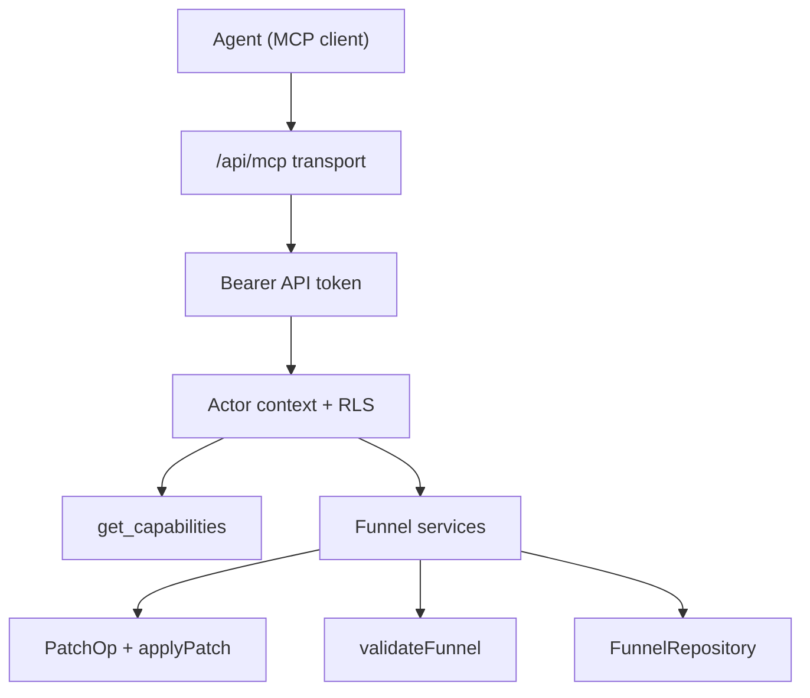

# Agent access (MCP)

> Planned: an MCP server inside every deployment, so an operator's agents can read, edit, validate and publish funnels with a personal API token, under the same RLS as the studio.

## Status

Not implemented. This page fixes the contract so code written now stays ready for a thin MCP adapter. The rules are in `CLAUDE.md` under "Operations contract". Each step below says what already exists and what is missing.

## Principles

- **Inside the image.** MCP is a route of the same Next.js app (`APP_URL/api/mcp`, streamable HTTP). Operators get it with their deployment. Nothing runs on our infrastructure.
- **Self-contained auth.** Tokens are issued in the operator's studio and stored in the operator's database (or `.data` in file mode). No external OAuth provider.
- **Capabilities, not assumptions.** Payments, AI, analytics and custom domains are optional per deployment. The agent asks `get_capabilities` first, and tools for missing features are not listed.
- **One contract.** Tools call the same services and `PatchOp`s as the studio, so behaviour never forks.
- **Versioned.** Operators upgrade on their own schedule. Tools report `apiVersion` and `schemaVersion`, and migrations go before code, as with RPCs (see [Deployment](../DEPLOYMENT.md)).
- **Off by default.** An env flag turns agent access on. It is added to the DEPLOYMENT.md table together with the code.

## Flow

## Planned tools

| Tool | Operation | Exists today |
|---|---|---|
| `get_capabilities` | `getCapabilities()` | No; the checks are spread across payments, AI and analytics code |
| `list_funnels` | `FunnelRepository` list | Yes, via `GET /api/funnels` |
| `get_funnel` | draft read | Yes, via `GET /api/funnels/[id]/draft` |
| `validate_funnel` | `validateFunnel` | Yes, pure function in `@funnel/schema` |
| `apply_patch` | `funnelPatchSchema` + `applyPatch` + validate + save with `expectedRevision` | Partly: schema and `applyPatch` exist, no endpoint |
| `publish_funnel` | publish | Yes, but the plan-key check lives only in the route |
| `rollback_funnel` | rollback | Yes, via `POST /api/funnels/[id]/rollback` |
| `list_versions` | versions | Yes, via `GET /api/funnels/[id]/versions` |
| `get_leads` | leads | Yes, via `GET /api/funnels/[id]/leads` |
| `generate_from_brief` | AI brief | Yes, via `/api/ai/brief/*`; only when AI is configured |

## Steps

### Step: Transport

A streamable HTTP MCP endpoint in the app, reachable on the platform host only (never on tenant hosts, like the rest of the funnel API). Each tool is a thin wrapper: parse with the operation's zod schema, call the service, return the result or typed issues.

**Code:** not written yet. Planned: `apps/web/src/app/api/mcp/route.ts`.

**Data:** none of its own.

**Failure modes:** with agent access disabled by env the endpoint answers 404. Unknown tool or invalid input returns an MCP error carrying the zod issues.

### Step: API tokens

Users create named tokens in the studio. The plain token is shown once and only its hash is stored. Tokens carry scopes (read, write, publish), can be revoked, and record `last_used_at`.

**Code:** not written yet. Planned: an `api_tokens` migration, a file-mode store in `.data`, a studio panel, and a bearer path in `withStudio` (`apps/web/src/server/api-helpers.ts`).

**Data:** `api_tokens` (`user_id`, `project_id`, `name`, `token_hash`, `scopes`, `created_at`, `last_used_at`, `revoked_at`), with RLS limiting rows to their owner.

**Failure modes:** missing, unknown or revoked token answers 401. A token without the required scope answers 403.

### Step: Actor context and RLS

A token resolves to the same actor a cookie session would. Queries must keep running under RLS. The open decision is how to do that: mint a short-lived user JWT signed with the Supabase project's key (needs one more env var), or a security-definer RPC with an explicit ownership check. Minting is preferred because it keeps the default-deny model of [SECURITY](../SECURITY.md). The decision is recorded there when made.

**Code:** today `getStudioContext()` in `apps/web/src/server/repository.ts` builds the context from cookies only.

**Data:** none of its own.

**Failure modes:** a token for another tenant's funnel gets 404, same as the studio.

### Step: Capabilities

One function reports what this deployment supports: storage mode, payment provider or none, configured AI providers, analytics, custom domains, `APP_URL`, `schemaVersion`, `apiVersion`. The studio and MCP both read it.

**Code:** not written yet. Planned: `apps/web/src/server/capabilities.ts`.

**Data:** env only, read at start-up.

**Failure modes:** a tool for a disabled feature is not listed. If it is called anyway, it returns a `feature_disabled` error.

### Step: Funnel services

Framework-free functions `(ctx, input)` used by route handlers and MCP alike: get, apply patch (load draft, `applyPatch`, validate, save with `expectedRevision`), publish, rollback, list versions.

**Code:** not written yet. Planned: `apps/web/src/server/services/funnels.ts`. Today the logic is split between route handlers under `apps/web/src/app/api/funnels/` and the repositories.

**Data:** through `FunnelRepository`.

**Failure modes:** a stale `expectedRevision` returns a conflict, and the agent must re-read the draft.

### Step: Patch operations

All edits are `PatchOp`s: `add_screen`, `replace_screen`, `insert_elements`, `remove_screen`, `add_edge`, `remove_edge`, `set_start_screen`, `set_theme`, `set_texts`. The studio editor still edits the definition directly in places, and those operations must move onto patches before MCP ships, so the UI and agents behave the same.

**Code:** `packages/funnel-schema/src/patch.ts` (`patchOpSchema`, `funnelPatchSchema`, `themePatchSchema`, `applyPatch`, `summarizePatch`) and `textEditSchema` in `packages/funnel-schema/src/text-edits.ts`. `PatchOp` is inferred from `patchOpSchema`, so the type and the schema cannot drift. Every op and field carries a `.describe()`, and `z.toJSONSchema(funnelPatchSchema)` gives the MCP input schema. A patch holds at most `MAX_PATCH_OPS` (200) operations. The AI assistant still uses its own `assistantOpSchema` in `packages/funnel-schema/src/assistant.ts`.

**Data:** the draft definition.

**Failure modes:** an op that references a missing screen or edge must return a typed issue, not throw.

### Step: Validation

`validateFunnel` returns `ValidationIssue`s with a `code`, `severity`, `message` and optional `screenId` or `edgeId`. That shape is what agents receive. Publish rules live here. `validateFunnel(def, { planKeys })` reports `unknown_plan` for plan keys missing from the catalogue the caller passes in (the package reads no env), and `element_props_invalid` for elements whose props fail their schema in `ELEMENT_PROP_SCHEMAS`. Both are errors in publish mode and warnings in save mode. The publish route still answers its own `unknown_plan` 400 with the known keys; the planned publish service will pass `planKeys` instead.

**Code:** `packages/funnel-schema/src/validate.ts`, `apps/web/src/server/validate-definition.ts` (`checkDefinition`), `packages/funnel-schema/src/element-props.ts` (`ELEMENT_PROP_SCHEMAS`, `unknownPlanKeys`, `isPlanBound`, `usesPickerPlan`).

**Data:** the definition, plus the plan catalogue from `PAYMENT_PLANS_JSON`.

**Failure modes:** prop schemas cover inputs and paywall elements (Rating, Slider, TextInput, DatePicker, Checkbox, plan and trial pickers, WalletButton, Totals). Heading, Paragraph, Image, OptionList, EmailInput, PriceCard, CheckoutBlock, ResultSummary and Button still keep their schemas in `apps/web/src/lib/puck`, so their props are not checked by `validateFunnel` yet.
